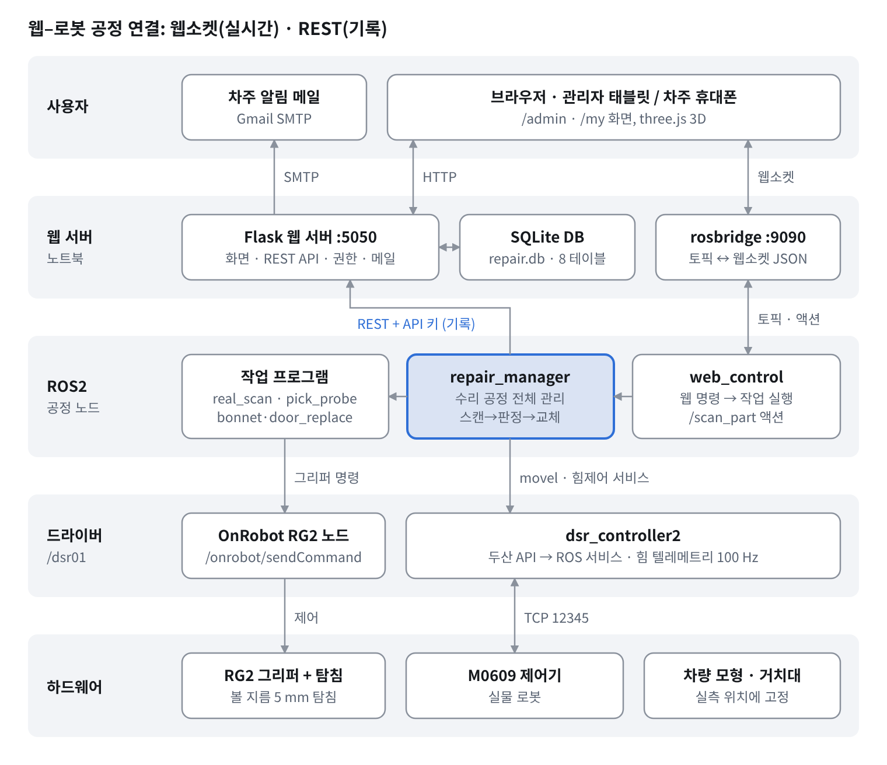
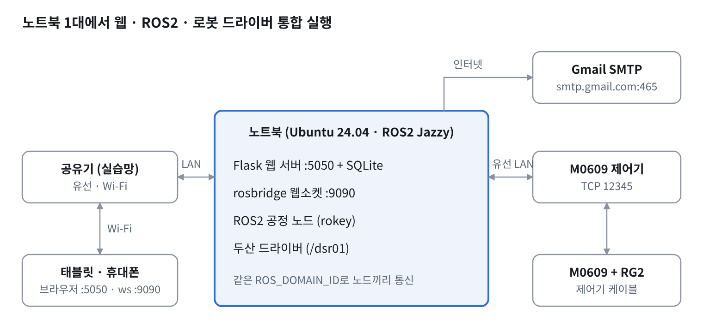
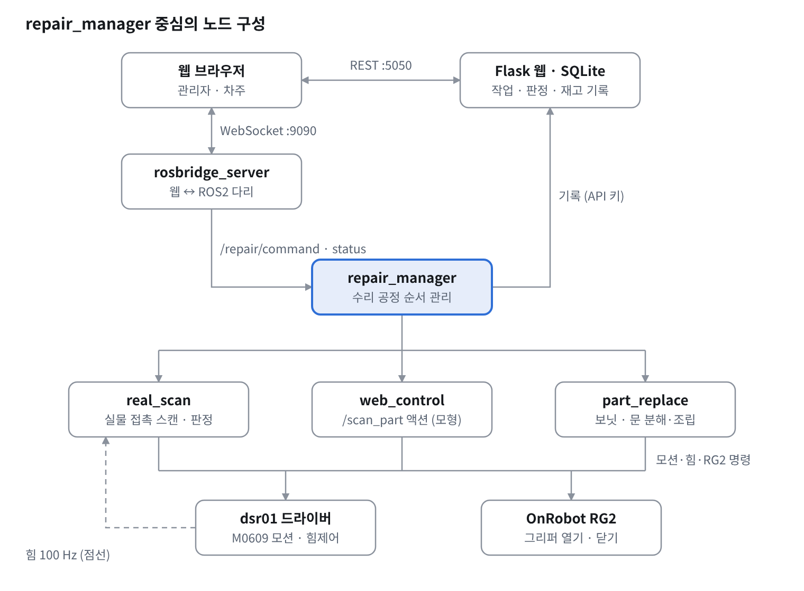

# Scan&Fix — ROS2를 활용한 자동차 자동 수리 로봇
> **조 이름:** B-3 (협동-1) - ROKEY
> **팀원:** 조윤영(팀장)_최원준_지민관_송세진

두산 협동로봇 **M0609**가 탐침으로 차체 표면을 직접 짚어(**접촉 스캔**) 손상 부위를 찾고, 손상된 부품을 **로봇이 직접 분해·조립해 교체**하는 것을 목표로 한 프로젝트입니다.
카메라 없이 힘 센서와 순응·힘제어만 사용하며, 정비소 관리자와 차주는 **웹 화면**에서 진행 상황과 결과를 실시간으로 확인합니다.

```text
웹 [수리 시작] → 탐침 파지 → 접촉 스캔 → 손상 판정 → 재고 확인 → 부품 교체(분해·조립) → 기록 · 완료 메일
```

| 이름 | 담당 |
|:---:|:---|
| 조윤영 (팀장) | 프로젝트 총괄, 웹/DB, 부품 교체(분해·조립) |
| 최원준 | ROS2 노드 설계, 힘제어 스캔 · 손상 판정 |
| 지민관 | 3D 모델링 및 프린팅 |
| 송세진 | 하부 하드웨어, 발표 자료 |

---

## 1. 🎨 시스템 설계 및 플로우 차트
프로젝트의 전체적인 구조와 소프트웨어 흐름도입니다.

### 1-1. 시스템 설계도 (System Architecture)
<p align="center">
  
</p>

* *설명: 사용자(웹) → 웹 서버 → ROS2 공정 노드 → 드라이버 → 하드웨어의 5계층 구조입니다. 실시간 값(관절 각도 · 측정 점 · 진행 단계)은 rosbridge 웹소켓으로, 남아야 하는 기록(단계 · 판정 · 교체 결과)은 REST API로 DB에 저장합니다.*

<p align="center">
  
</p>

* *설명: 노트북 1대에서 웹 서버(:5050), rosbridge(:9090), ROS2 노드(`repair_car`), 두산 드라이버를 모두 실행합니다. 실물 로봇은 네임스페이스 `/robot_1`, 가상 로봇은 `/robot_2`로 구분합니다. 로봇 제어기는 유선 LAN(TCP 12345), 태블릿 · 휴대폰은 같은 실습망 Wi-Fi로 연결합니다.*

### 1-2. 플로우 차트 (Flow Chart)
<p align="center">
  
</p>

* *설명: 웹에서 수리를 시작하면 `repair_manager`가 단계를 자동으로 이어 가며, 한 건의 수리는 완료(done) · 손상 없음(no_damage) · 수리 보류(on_hold) · 중지(stopped) · 실패(failed) 중 하나로 끝납니다. 자동 모드는 스캔으로 손상을 찾고, 수동 모드는 관리자가 지정한 부품을 스캔 없이 교체합니다.*

### 1-3. ROS2 노드 구성
<p align="center">
  
</p>

아래 실행 파일은 모두 `ros2 run repair_car <이름>`으로 실행합니다 (`setup.py`의 `entry_points`).
웹 세션에서는 토픽 이름 앞에 로봇 네임스페이스가 붙습니다 (예: `/robot_1/repair/command`).

- **repair_manager** (`repair_car.web.repair_manager`)
  - 수리 1건의 단계 진행: calibrate → plan → scan → stock → replace → inspect → done
  - 구독: `/repair/command` (웹의 시작 · 정지 명령)
  - 발행: `/repair/status`, `/repair/vehicle`
  - 서비스 클라이언트: `lift/command` (`LiftCommand`, 가상 `demo_final` 리프트)
  - 기록: Flask REST API 호출 (`X-API-Key` 인증)
- **web_control** (`repair_car.web.web_control`)
  - 웹 명령을 받아 로봇 프로그램(탐침 파지 · 검사 · 교체)을 한 번에 하나씩 실행 · 정지
  - 구독: `/robot/command`, `/repair/command`, `/scan/progress`, `/scan/result`
  - 발행: `/robot/status`
  - 액션 서버: `/scan_part` (`custom_interfaces/action/ScanPart`)
- **real_scan** (`repair_car.inspection.real_scan`)
  - 실물 차량 접촉 스캔 · 손상(dent · crack) 판정 (DSR 순응제어 + 힘제어, `--controller mesh-height`)
  - 구독: `realtime/force_telemetry` (`dsr_msgs2/ForceTelemetry`, 팀이 드라이버에 추가한 메시지)
  - 발행: `/scan/samples`, `/scan/progress`, `/scan/roi`, `/scan/result`
- **pointcloud** (`repair_car.pointcloud.publisher`, 노드 이름 `repair_pointcloud`)
  - 구독: `/repair/vehicle`, `/repair/status` → 발행: `/repair/pointcloud`, `/repair/scan_points`
- **part_replace** (`bonnet_replace`, `door_replace`, `replace_parts`)
  - 티치 펜던트로 만든 DRL을 Python(DSR_ROBOT2)으로 옮긴 보닛 · 문 분해 · 조립
  - 보닛 분해 9 · 조립 8단계, 문 분해 7 · 조립 7단계 (`--side left|right`, 오른쪽 문은 왼쪽 경로의 BASE XZ 대칭)
  - 속도는 DRL 기본값의 20 % (`SPEED_SCALE = 0.2`)
- **pick_probe / release_probe**: 탐침 집기 · 반납
- **lift_bridge** (`repair_car.lift.node`, 노드 이름 `lift`): 서비스 `/lift/command`, 발행 `/lift/status`
- **teleop**: 키보드 · 웹 버튼으로 로봇 수동 이동, 그리퍼 열기 · 닫기
- **rosbridge_server**: 웹 브라우저 ↔ ROS2 토픽 중계 (WebSocket 9090)
- **두산 드라이버** (`dsr_controller2`, `dsr_hardware2`): M0609 모션 · 힘제어 서비스, `joint_states`, `realtime/force_telemetry`
- **OnRobot RG2** (`onrobot_rg_control`): 그리퍼 열기 · 닫기

> 사용자 정의 메시지 · 서비스 · 액션: `custom_interfaces` (`ContactSample`, `ContactSampleArray`, `RoiRegion`, `RoiArray`, `CartesianSetpoint`, `CartesianState`, `PosePdConfig`, `JointServoSetpoint`, `JointServoStatus`, `LiftStatus`, `CartesianSession.srv`, `JointServoSession.srv`, `LiftCommand.srv`, `ScanPart.action`) — 전체 토픽 목록은 [ROS_INTERFACES.md](ws_cobot_pjt/src/repair_car/docs/ROS_INTERFACES.md)

---

## 2. 🖥️ 운영체제 환경 (OS Environment)
이 프로젝트는 다음 환경에서 개발하였습니다.

* **OS:** Ubuntu 24.04 LTS (실물 로봇 연결), macOS + Docker (가상 로봇 개발)
* **ROS Version:** ROS2 Jazzy
* **Language:** Python 3.12, C++ (드라이버 수정분), JavaScript (웹 화면)
* **IDE:** VS Code
* **시뮬레이션:** Gazebo Harmonic (가상 로봇), RViz2
* **실행 방식:** ROS2 제어 · rosbridge는 Docker 컨테이너(`ws_cobot_pjt`), Gazebo · RViz · 웹 서버는 호스트에서 실행
* **로봇 드라이버:** `doosan-robot2` (`dsr_controller2`, DSR_ROBOT2 Python API), `onrobot-ros2` — 팀 수정분 포함 ([cobot_rg2_patches/](cobot_rg2_patches))

---

## 3. 🛠️ 사용 장비 목록 (Hardware List)
프로젝트에 사용된 주요 하드웨어 장비입니다.

| 장비명 (Model) | 수량 | 비고 |
|:---:|:---:|:---|
| Doosan Robotics M0609 | 1 | 6축 협동로봇, 제어기와 유선 LAN 연결 (TCP 12345) |
| OnRobot RG2 | 1 | 그리퍼, 탐침 파지 · 부품 잡기 (Modbus TCP) |
| 접촉 탐침 | 1 | 3D 프린팅, 볼 지름 5 mm, TCP 282.5 mm |
| 차량 모형 | 1 | 3D 프린팅, 보닛 · 문 탈착식 |
| 교체 부품 (보닛 · 문) | 각 1 | 3D 프린팅 |
| 탐침 거치대 · 부품 거치대 | 각 1 | 3D 프린팅, 위치 고정 |
| 노트북 (Ubuntu 24.04) | 1 | ROS2 노드 · 웹 서버 · DB 실행 |
| 태블릿 · 휴대폰 | 각 1 | 관리자 화면 · 차주 화면 (브라우저) |

> 차량 · 탐침 · 거치대 3D 모델 파일은 [ws_cobot_pjt/src/repair_car/meshes/](ws_cobot_pjt/src/repair_car/meshes) 폴더에 있습니다.

---

## 4. 📦 의존성 (Dependencies)
프로젝트 실행에 필요한 라이브러리입니다.

### ROS 2 (apt)
* `ros-jazzy-desktop`
* `ros-jazzy-rosbridge-server`
* `rclpy`, `std_msgs`, `std_srvs`, `sensor_msgs`, `geometry_msgs`, `visualization_msgs`, `tf2_ros`, `launch_ros`
* 나머지 apt 패키지는 `rosdep install --from-paths src --ignore-src --rosdistro jazzy -r -y`로 설치합니다 (각 `package.xml` 기준)

### 외부 드라이버 (이 압축 파일에 포함되지 않음 → 받아서 함께 빌드)
* **두산 드라이버** `doosan-robot2` (`dsr_msgs2`, `dsr_common2`, `dsr_controller2`, `dsr_hardware2`, `dsr_description2` …)
* **OnRobot 드라이버** `onrobot-ros2` (`onrobot_rg_msgs`, `onrobot_rg_control`, `onrobot_rg_description`)
* 두 드라이버 모두 [ahnisinc/cobot_rg2](https://github.com/ahnisinc/cobot_rg2)에서 받아 `ws_cobot_pjt/src/cobot_rg2/` 아래에 둡니다.
* ⚠️ 팀이 수정한 드라이버 파일 13개(`ForceTelemetry.msg` 추가 등)를 [cobot_rg2_patches/](cobot_rg2_patches)에 같은 경로로 넣어 두었습니다. **원본을 받은 뒤 반드시 덮어써야** 접촉 스캔(`realtime/force_telemetry`)이 동작합니다. (아래 Step 0)

### Python (pip): [`requirements.txt`](requirements.txt)
```txt
Flask>=3.0,<4
PyYAML>=6
numpy
scipy
matplotlib
```
* RG2 그리퍼 드라이버용: `pymodbus==3.6.9` (Docker 이미지에는 자동 설치)

### 웹 화면 (브라우저)
* three.js (3D 차량 · 로봇), roslibjs (rosbridge 연결), urdf-loader — 모두 `ws_cobot_pjt/src/repair_car/repair_car/web/static/vendor/`에 포함

---

## 5. ▶️ 실행 순서 (Usage Guide)
프로젝트를 실행하기 위한 순서입니다. 터미널 명령어를 순서대로 입력해 주세요.
아래에서 **`<압축 해제 폴더>`** 는 이 README.md가 있는 `rokey-b3-project1/` 폴더입니다.
> ⚠️ 압축 해제 경로에 **한글이 들어가면** `custom_interfaces` 빌드(rosidl)가 실패합니다. 영문 경로에 풀어 주세요 (예: `~/rokey-b3-project1`).

> ⚠️ **실물 로봇은 반드시 저속으로, 비상정지(E-stop) 앞에 사람이 대기한 상태에서 실행합니다.**

### Step 0. 외부 드라이버 받기 + 팀 수정분 덮어쓰기 (최초 1회)
```bash
cd <압축 해제 폴더>/ws_cobot_pjt/src/cobot_rg2
git clone https://github.com/ahnisinc/cobot_rg2 /tmp/cobot_rg2_upstream
cp -r /tmp/cobot_rg2_upstream/doosan-robot2 /tmp/cobot_rg2_upstream/onrobot-ros2 .
cp -r ../../../cobot_rg2_patches/doosan-robot2 ../../../cobot_rg2_patches/onrobot-ros2 .
```

### Step 1. 빌드 환경 준비 — 둘 중 하나

**(A) Docker (기본, 실행 스크립트가 사용하는 방식)**
```bash
cd <압축 해제 폴더>
docker compose -f ws_cobot_pjt/src/repair_car/Docker/compose.yaml build cobot
# 컨테이너 안 colcon 빌드는 Step 2의 실행 스크립트가 자동으로 준비합니다.
```
* 호스트에는 ROS 2 Jazzy · RViz, Gazebo Harmonic과 Python 바인딩(`python3-gz-transport13`, `python3-gz-msgs10`), NumPy · SciPy · PyYAML이 필요합니다.
* macOS는 Docker Desktop과 conda 환경을 사용합니다: `conda env create -f ws_cobot_pjt/src/repair_car/native/environment.yml`

**(B) Ubuntu에서 Docker 없이 직접 빌드**
```bash
cd <압축 해제 폴더>/ws_cobot_pjt
source /opt/ros/jazzy/setup.bash
rosdep install --from-paths src --ignore-src --rosdistro jazzy -r -y
colcon build --symlink-install
source install/setup.bash

cd <압축 해제 폴더>
pip install -r requirements.txt pymodbus==3.6.9   # 가상환경 권장
```

### Step 2. 로봇 세션 실행 (드라이버 + 수리 노드 + 웹) — 터미널 1
```bash
cd <압축 해제 폴더>/ws_cobot_pjt/src/repair_car

# 실물 로봇 (/robot_1) + 웹
./launch/run_real.sh <로봇 IP> --web --no-gazebo

# 가상 로봇 (/robot_2, Gazebo, demo_final 리프트) + 웹
./launch/run_virtual.sh --web
```
* `run_real.sh <로봇 IP> --with-sim --web` 은 실물 `/robot_1`과 가상 `/robot_2`를 함께 실행합니다.
* 웹 서버는 Flask **:5050**, rosbridge는 **:9090**으로 열립니다.

### Step 3. (선택) 이미 실행 중인 세션에 웹만 붙이기 — 터미널 2
`--web` 없이 세션을 시작했을 때 사용합니다. Flask · rosbridge · `web_control`을 띄웁니다.
```bash
cd <압축 해제 폴더>/ws_cobot_pjt/src/repair_car
./launch/run_web.sh start          # 같은 Wi-Fi의 태블릿·휴대폰: ./launch/run_web.sh start --lan
./launch/run_web.sh status         # 상태 확인 (log: 로그, stop: 종료)
```

### Step 4. 웹에서 수리 시작
1. 브라우저에서 `http://<PC IP>:5050/admin?tab=robot` 접속 → 관리자 계정으로 로그인 (시연용 계정: `admin / admin1234`)
2. **로봇·수리** 탭에서 로봇(`/robot_1` 실물, `/robot_2` 가상)과 차량 선택
3. **자동 모드**(스캔으로 손상 찾기) 또는 **수동 모드**(교체할 부품 지정) 선택 → **[수리 시작]**
4. 차주 계정(휴대폰, `/my`)에서 3D 화면으로 진행 상황 확인 (시연용 계정: `user1 / user1234`), 시작 · 완료 시 알림 메일 수신
5. 언제든 **[정지]** → 즉시 정지(`move_stop`) → 힘 해제 → 순응 해제

### (참고) 개별 기능 단독 실행 (디버깅용)
Docker 방식은 컨테이너 안에서, 직접 빌드 방식은 `source install/setup.bash` 후 실행합니다. 네임스페이스는 실물 `/robot_1`, 가상 `/robot_2`입니다.
```bash
docker exec -it ws_cobot_pjt bash
source /opt/ros/jazzy/setup.bash && source /workspace/install/setup.bash

ros2 run repair_car pick_probe --ros-args -r __ns:=/robot_2                                   # 탐침 집기
ros2 run repair_car real_scan --part bonnet --controller mesh-height --ros-args -r __ns:=/robot_2  # 보닛 접촉 스캔
ros2 run repair_car real_scan --part door --side left --controller mesh-height --ros-args -r __ns:=/robot_2
ros2 run repair_car release_probe --ros-args -r __ns:=/robot_2                                # 탐침 반납
ros2 run repair_car bonnet_replace all --virtual --ros-args -r __ns:=/robot_2                 # 보닛 분해 → 조립 (실물은 --virtual 빼기)
ros2 run repair_car door_replace all --side left --virtual --ros-args -r __ns:=/robot_2       # 왼쪽 문 분해 → 조립
ros2 run repair_car teleop --ros-args -r __ns:=/robot_2                                       # 키보드 수동 조작
```

### (참고) Docker 없이 노드를 하나씩 실행 (Step 1-B 빌드 후)
```bash
# 터미널 1: 로봇 연결 (두산 드라이버 + RG2)
cd <압축 해제 폴더>/ws_cobot_pjt && source install/setup.bash
ros2 launch m0609_rg2_bringup bringup.launch.py mode:=real host:=<로봇 IP>     # 가상: mode:=virtual

# 터미널 2: 수리 공정 노드 + rosbridge(:9090)
cd <압축 해제 폴더>/ws_cobot_pjt && source install/setup.bash
ros2 launch repair_car repair.launch.py rosbridge:=true      # repair_manager, pointcloud, rosbridge

# 터미널 3: 웹 명령 실행 노드
cd <압축 해제 폴더>/ws_cobot_pjt && source install/setup.bash
ros2 run repair_car web_control

# 터미널 4: 웹 서버 (http://<PC IP>:5050)
cd <압축 해제 폴더>/ws_cobot_pjt/src/repair_car/repair_car/web
python3 app.py
```
* 이 방식은 기본 네임스페이스 `/dsr01`로 실행됩니다.

> 메일 발송용 SMTP 앱 비밀번호 등 비밀 값은 `ws_cobot_pjt/src/repair_car/config/web.env` 또는 환경변수에만 넣고 배포하지 않습니다 (`SMTP_HOST`, `SMTP_PORT`, `SMTP_USER`, `SMTP_PASS`, `SITE_URL`, `MAIL_DRY_RUN`).
> 자세한 내용: [repair_car/README.md](ws_cobot_pjt/src/repair_car/README.md) · [ARCHITECTURE](ws_cobot_pjt/src/repair_car/docs/ARCHITECTURE.md) · [NATIVE(세션 관리)](ws_cobot_pjt/src/repair_car/docs/NATIVE.md) · [WEB](ws_cobot_pjt/src/repair_car/docs/WEB.md) · [REPAIR](ws_cobot_pjt/src/repair_car/docs/REPAIR.md) · [INSPECTION](ws_cobot_pjt/src/repair_car/docs/INSPECTION.md)

---

## 6. 📊 결과 및 한계

* **연결됨:** 웹 명령 · 작업 관리, 탐침 파지 / 반납, HOME, 리프트 배치 · 세 패널 순회, 판정 집계, 확정 손상만 교환 호출, 재고 · DB · 알림 경로, 중지 · 가상 재시도 제한
* **교환 경로:** 보닛 · 도어 티칭 분해 / 조립이 있으며 오른쪽 도어는 왼쪽 경로의 BASE XZ 대칭입니다. 실기 자동 검사 · 수동 교체는 현재 보닛 대상입니다.
* **실행 기록:** 2026-11-23 선택 영역(각 10×10 mm) 웹 명령 실행에서 세 부품 · 여섯 경로가 완료되었습니다(약 533.5초, 수신 샘플 26,333개, 장면 자세 변경 37회). 전체 면 검사 · 물리 부품 교체 · 실기 명령 · 메일 실발송 완료를 의미하지 않습니다.
* **한계 · 남은 부분:** Gazebo에서 실제 부품이 분리되고 새 부품으로 바뀌는 모델, 교환 후 단차 측정, 사이드미러 등 기타 부품의 실제 교환이 남아 있습니다. 가상 수동 도어의 배치 준비도 보완이 필요합니다.

---

## 📁 폴더 구조
```text
rokey-b3-project1/                  # 압축 해제 폴더 (경로에 한글이 있으면 colcon 인터페이스 빌드가 실패하므로 영문 이름 유지)
├── README.md
├── LICENSE
├── requirements.txt               # 웹 서버 · 분석용 Python 패키지
├── docs/images/                   # 시스템 설계도 · 네트워크 · 플로우 차트 · 노드 구조도
├── cobot_rg2_patches/             # 팀이 수정한 외부 드라이버 파일 (doosan-robot2 · onrobot-ros2, 원본 경로 그대로)
└── ws_cobot_pjt/                  # ROS2 colcon 워크스페이스 (Docker 컨테이너의 /workspace)
    └── src/
        ├── custom_interfaces/     # 사용자 정의 메시지 · 서비스 · 액션
        ├── cobot_rg2/
        │   └── rg2/m0609_rg2_bringup/   # bringup · URDF · virtual_force_bridge
        │       (doosan-robot2/, onrobot-ros2/ 는 Step 0에서 받아 이 위치에 둠)
        └── repair_car/            # 프로젝트 ROS 패키지
            ├── launch/            # run_real.sh · run_virtual.sh · run_web.sh · run_rviz.sh · run_lift.sh · repair.launch.py
            ├── repair_car/        # Python 패키지
            │   ├── web/           #   Flask 웹 서버(:5050) · web_control · repair_manager · 화면(templates/static)
            │   ├── inspection/    #   real_scan · 접촉 스캔 · 손상 판정
            │   ├── part_replace/  #   bonnet_replace · door_replace (DRL 이식)
            │   ├── probe/         #   pick_probe · release_probe
            │   ├── robot_control/ #   로봇 서비스 · teleop
            │   ├── lift/          #   리프트 브리지 · 펌웨어 · 기구 자료
            │   └── calibration/ · pointcloud/ · report/ · experiments/ · geometry/ …
            ├── native/            # 호스트 Gazebo · RViz · 세션 관리
            ├── Docker/            # Dockerfile · compose.yaml · 에뮬레이터
            ├── config/            # robot.yaml · real_scene.yaml · vehicles.yaml 등
            ├── meshes/            # 차량 · 탐침 · 거치대 3D 모델
            ├── pointcloud/        # 기준 점군
            └── docs/              # 기능 문서 · 기술 보고서 PDF
```

## 라이선스
* 이 프로젝트: MIT — [LICENSE](LICENSE)
* 의존 드라이버 `doosan-robot2`: Apache License 2.0 (`onrobot-ros2`: MIT)
