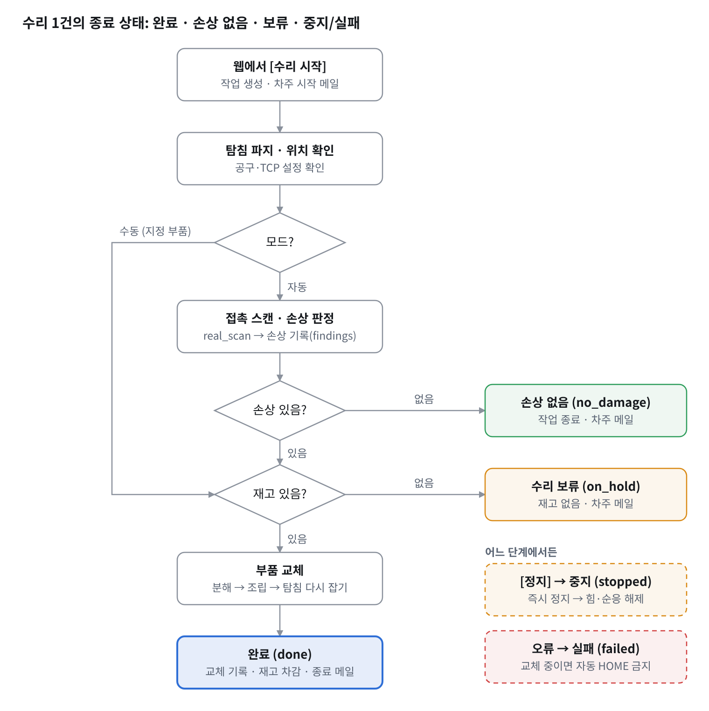

# Scan&Fix — ROS2를 활용한 자동차 자동 수리 로봇
> **조 이름:** B-3 (협동-1) - ROKEY
> **팀원:** 조윤영_최원준_지민관_송세진

두산 협동로봇 **M0609**가 탐침으로 차체 표면을 직접 짚어(**접촉 스캔**) 손상 부위를 찾고, 손상된 부품을 **로봇이 직접 분해·조립해 교체**하는 프로젝트입니다.
카메라 없이 힘 센서와 순응·힘제어만 사용하며, 정비소 관리자와 차주는 **웹 화면**에서 진행 상황과 결과를 실시간으로 확인합니다.

```text
웹 [수리 시작] → 탐침 파지 → 접촉 스캔 → 손상 판정 → 재고 확인 → 부품 교체(분해·조립) → 기록 · 완료 메일
```

| 이름 | 담당 |
|:---:|:---|
| 조윤영 (팀장) | 프로젝트 총괄, 웹/DB, 부품 교체(분해·조립) |
| 최원준 | ROS2 노드 설계, 힘제어 스캔 · 손상 판정 |
| 지민관 | 3D 모델링 및 프린팅 |
| 송세진 | 하부 하드웨어, 발표 자료 |

---

## 1. 🎨 시스템 설계 및 플로우 차트
프로젝트의 전체적인 구조와 소프트웨어 흐름도입니다.

### 1-1. 시스템 설계도 (System Architecture)
<p align="center">
  
</p>

* *설명: 사용자(웹) → 웹 서버 → ROS2 공정 노드 → 드라이버 → 하드웨어의 5계층 구조입니다. 실시간 값(관절 각도 · 측정 점 · 진행 단계)은 rosbridge 웹소켓으로, 남아야 하는 기록(단계 · 판정 · 교체 결과)은 REST API로 DB에 저장합니다.*

<p align="center">
  
</p>

* *설명: 노트북 1대에서 웹 서버(:5050), rosbridge(:9090), ROS2 노드, 두산 드라이버를 모두 실행합니다. 로봇 제어기는 유선 LAN(TCP 12345), 태블릿 · 휴대폰은 같은 실습망 Wi-Fi로 연결합니다.*

### 1-2. 플로우 차트 (Flow Chart)
<p align="center">
  
</p>

* *설명: 웹에서 수리를 시작하면 `repair_manager`가 단계를 자동으로 이어 가며, 한 건의 수리는 완료(done) · 손상 없음(no_damage) · 수리 보류(on_hold) · 중지(stopped) · 실패(failed) 중 하나로 끝납니다. 자동 모드는 스캔으로 손상을 찾고, 수동 모드는 관리자가 지정한 부품을 스캔 없이 교체합니다.*

### 1-3. ROS2 노드 구성
<p align="center">
  
</p>

- **repair_manager** (`rokey.repair_manager`)
  - 수리 1건의 단계 진행: plan → scan → detect → stock → replace → inspect → done
  - 구독: `/repair/command` (웹의 시작 · 정지 명령)
  - 발행: `/repair/status`, `/repair/vehicle`
  - 기록: Flask REST API 호출 (`X-API-Key` 인증)
- **real_scan** (`rokey.real_scan`)
  - 실물 차량 접촉 스캔 · 손상 판정 (DSR 순응제어 + 힘제어)
  - 구독: `realtime/force_telemetry` (힘 · 토크 100 Hz)
  - 발행: `/scan/progress`, `/scan/roi`, `/scan/samples`, `/scan/result`
- **web_control** (`rokey.web_control`)
  - 웹 명령을 받아 로봇 프로그램 실행
  - 액션 서버: `/scan_part` (`ScanPart.action`)
- **part_replace** (`rokey.part_replace.bonnet_replace`, `door_replace`)
  - 티치 펜던트로 만든 DRL을 Python(DSR_ROBOT2)으로 옮긴 보닛 · 왼쪽 문 분해 · 조립
  - 보닛 분해 9 · 조립 8단계, 왼쪽 문 분해 7 · 조립 7단계, 속도 DRL 기본값의 20 %
- **rosbridge_server**: 웹 브라우저 ↔ ROS2 토픽 중계 (WebSocket 9090)
- **dsr01 드라이버** (`dsr_controller2`): M0609 모션 · 힘제어 서비스, `/dsr01/joint_states`
- **OnRobot RG2**: 그리퍼 열기 · 닫기 (`/onrobot/sendCommand`)

> 사용자 정의 메시지 · 액션: `rokey_interfaces` (`RoiRegion`, `RoiArray`, `ContactSample`, `ScanPart.action`) — 전체 토픽 목록은 [docs/INTERFACE.md](docs/INTERFACE.md)

---

## 2. 🖥️ 운영체제 환경 (OS Environment)
이 프로젝트는 다음 환경에서 개발하였습니다.

* **OS:** Ubuntu 24.04 LTS (실물 로봇 연결), macOS + Docker (가상 로봇 개발)
* **ROS Version:** ROS2 Jazzy
* **Language:** Python 3.12, JavaScript (웹 화면)
* **IDE:** VS Code
* **로봇 드라이버:** `doosan-robot2` (`dsr_controller2`, DSR_ROBOT2 Python API), `onrobot-ros2`

---

## 3. 🛠️ 사용 장비 목록 (Hardware List)
프로젝트에 사용된 주요 하드웨어 장비입니다.

| 장비명 (Model) | 수량 | 비고 |
|:---:|:---:|:---|
| Doosan Robotics M0609 | 1 | 6축 협동로봇, 제어기와 유선 LAN 연결 (TCP 12345) |
| OnRobot RG2 | 1 | 그리퍼, 탐침 파지 · 부품 잡기 |
| 접촉 탐침 | 1 | 3D 프린팅, 볼 지름 5 mm, TCP 282.5 mm |
| 차량 모형 | 1 | 3D 프린팅, 보닛 · 왼쪽 문 탈착식 |
| 교체 부품 (보닛 · 문) | 각 1 | 3D 프린팅 |
| 탐침 거치대 · 부품 거치대 | 각 1 | 3D 프린팅, 위치 고정 |
| 노트북 (Ubuntu 24.04) | 1 | ROS2 노드 · 웹 서버 · DB 실행 |
| 태블릿 · 휴대폰 | 각 1 | 관리자 화면 · 차주 화면 (브라우저) |

> 3D 모델 파일은 [cad/](cad) 폴더에 있습니다.

---

## 4. 📦 의존성 (Dependencies)
프로젝트 실행에 필요한 라이브러리입니다.

### ROS 2 (apt)
* `ros-jazzy-desktop`
* `ros-jazzy-rosbridge-server`
* `rclpy`, `std_msgs`, `std_srvs`, `sensor_msgs`, `geometry_msgs`, `visualization_msgs`, `tf2_ros`, `launch_ros`
* 두산 드라이버 `dsr_msgs2`, `dsr_common2`, `dsr_controller2` (저장소의 `doosan-robot2`를 함께 빌드)
* OnRobot 드라이버 `onrobot_rg_msgs`, `onrobot_rg_control` (저장소의 `onrobot-ros2`를 함께 빌드)

### Python (pip): [`requirements.txt`](requirements.txt)
```txt
Flask>=3.0,<4
PyYAML>=6
numpy
scipy
matplotlib
```

### 웹 화면 (브라우저, CDN)
* three.js (3D 차량 · 로봇), roslibjs (rosbridge 연결)

---

## 5. ▶️ 실행 순서 (Usage Guide)
프로젝트를 실행하기 위한 순서입니다. 터미널 명령어를 순서대로 입력해 주세요.

> ⚠️ **실물 로봇은 반드시 저속으로, 비상정지(E-stop) 앞에 사람이 대기한 상태에서 실행합니다.**

### Step 0. 워크스페이스 빌드 및 설치
```bash
source /opt/ros/jazzy/setup.bash
cd rokey-b3-project1/ws_cobot_pjt/ws_cobot_pjt
colcon build --symlink-install
source install/setup.bash

# 웹 서버용 Python 패키지 (가상환경 권장)
cd ../../web
python3 -m venv .venv && source .venv/bin/activate
pip install -r requirements.txt
```

### Step 1. 로봇 연결 (두산 드라이버 + RG2) — 터미널 1
```bash
ros2 launch m0609_rg2_bringup bringup.launch.py mode:=real host:=<로봇 IP>
# 가상 로봇으로 테스트할 때: mode:=virtual
```

### Step 2. 수리 공정 노드 + rosbridge 실행 — 터미널 2
```bash
source install/setup.bash
ros2 launch rokey repair.launch.py rosbridge:=true      # repair_manager, pointcloud, rosbridge(:9090)
```

### Step 3. 웹 명령 실행 노드 — 터미널 3
```bash
source install/setup.bash
ros2 run rokey web_control
```

### Step 4. 웹 서버 실행 — 터미널 4
```bash
cd web && source .venv/bin/activate
python3 app.py                                          # http://<PC IP>:5050
```

### Step 5. 웹에서 수리 시작
1. 관리자 계정으로 로그인 → **로봇·수리** 탭에서 차량 선택
2. **자동 모드**(스캔으로 손상 찾기) 또는 **수동 모드**(교체할 부품 지정) 선택 → **[수리 시작]**
3. 차주 계정(휴대폰)에서 3D 화면으로 진행 상황 확인, 시작 · 완료 시 알림 메일 수신
4. 언제든 **[정지]** → 즉시 정지(QSTOP) → 힘 해제 → 순응 해제

### (참고) 개별 기능 단독 실행 (디버깅용)
```bash
ros2 run rokey pick_probe                                # 탐침 집기
ros2 run rokey real_scan --part bonnet                   # 보닛 접촉 스캔
ros2 run rokey bonnet_replace all                        # 보닛 분해 → 조립
ros2 run rokey door_replace all                          # 왼쪽 문 분해 → 조립
```

### (참고) 스크립트 실행 (macOS + Docker 가상 세션)
```bash
./ws_cobot_pjt/run_virtual.sh --car real --probe ball --web   # 가상 로봇 + 웹
./ws_cobot_pjt/run_real.sh <로봇 IP>                           # 실물 로봇
./ws_cobot_pjt/run_web.sh start                                # 실행 중인 세션에 웹 · rosbridge · web_control 붙이기
```

> 메일 발송용 Gmail 앱 비밀번호 등 비밀 값은 `web/.env`에만 넣고 커밋하지 않습니다.
> 자세한 내용: [web/README.md](web/README.md) · [ws_cobot_pjt/README.md](ws_cobot_pjt/README.md) · [part_replace/README.md](ws_cobot_pjt/ws_cobot_pjt/src/rokey/rokey/part_replace/README.md)

---

## 6. 📊 결과 및 한계

* 웹에서 수리 시작 → 보닛 스캔 → 손상 판정 → 보닛 분해 · 조립까지 **실물 로봇으로 연결 완료** (2026-11-21)
* 왼쪽 문 분해를 실물로 확인, 문 조립은 보완 중
* 한계: 스캔 시간이 김(보닛 약 30분대), 교체 가능한 부품이 보닛 · 왼쪽 문으로 한정

---

## 📁 폴더 구조
```text
rokey-b3-project1/
├── web/                    # Flask 웹 서버 (:5050) — 관리자 · 차주 화면, REST API, 알림 메일, SQLite
├── ws_cobot_pjt/           # ROS2 워크스페이스 · 실행 스크립트
│   └── ws_cobot_pjt/src/
│       ├── rokey/          #   수리 공정 · 스캔 · 부품 교체 노드 (part_replace/)
│       ├── rokey_interfaces/   # 사용자 정의 메시지 · 액션
│       └── cobot_rg2/      #   두산 드라이버 · RG2 그리퍼 · bringup
├── cad/                    # 3D 모델 (차량, 보닛, 탐침, 리프트)
├── docs/                   # 인터페이스 문서, 다이어그램 이미지
└── requirements.txt
```

## 라이선스
[LICENSE](LICENSE)
