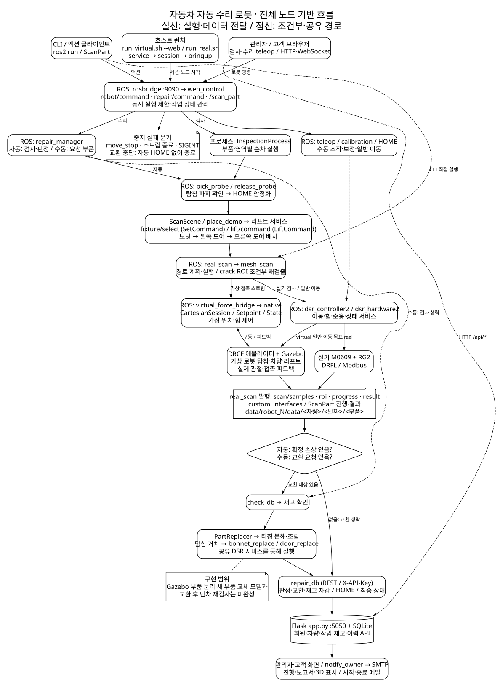

# 자동차 자동 수리 로봇 · M0609 / RG2 ROS 워크스페이스

**ROKEY 협동-1 · B그룹 3조**

Doosan M0609와 OnRobot RG2로 탐침을 파지하고, **촉각·힘 제어로 차량 표면을 스캔**하여 손상(dent·crack)을 찾는 ROS 2 Jazzy 시스템입니다. 비전 기반 손상 판정을 사용하지 않습니다. 전체 공정은 **표면 스캔 → 손상 판정 → 재고 확인 → 부품 교체 → 장착 단차 재검사 → 완료 알림**이며, 수동 모드는 스캔·판정을 건너뛰고 요청한 부품을 교체합니다.

초기 기획의 교체 대상은 보닛·사이드미러이며, 현행 티칭 동작은 보닛과 좌·우 도어에 연결되어 있습니다. 전체 공정의 목표와 현재 구현 범위는 구분합니다. Gazebo 부품 분리·교체와 단차 재검사 등 남은 부분은 문서 하단에 정리했습니다.

기존 프로젝트 최상위 README의 소개·팀·웹·ROS 배포 안내와 표면 측정 워크스페이스 README의 구조·실행·검출·통신 내용을 현재 경로로 통합했습니다. 정리 기준일: **2026-11-24**.

## 팀원

| 이름 | 담당 |
|---|---|
| 조윤영 | 미기재 |
| 최원준 | 미기재 |
| 송세진 | 미기재 |
| 지민관 | 미기재 |

## 전체 노드 기반 흐름도



흰색 노드·검은색 선으로 표현했습니다. 실선은 실행·데이터 전달, 점선은 조건부·공유 경로입니다. 상자에는 ROS 노드뿐 아니라 작업 프로세스·장치·저장소도 포함되며 역할을 이름에 표시했습니다. [Graphviz 원본](ws_cobot_pjt/src/repair_car/docs/diagrams/system_flow_bw.dot)과 [PNG](ws_cobot_pjt/src/repair_car/docs/images/system_flow_bw.png)를 함께 제공합니다.

## 디렉토리와 호출 관계

```text
rokey-b3-project1/                          저장소 루트
├── README.md                              전체 구성·실행·구현 범위
├── .gitignore                             빌드·검증 데이터·캐시·로컬 비밀 설정 제외
└── ws_cobot_pjt/                           colcon 워크스페이스 → 컨테이너 /workspace
    └── src/
        ├── custom_interfaces/             ScanPart·샘플·ROI·Cartesian·리프트 인터페이스
        ├── cobot_rg2/
        │   ├── doosan-robot2/              DSR 드라이버·서비스·하드웨어·로봇 모델
        │   ├── onrobot-ros2/               RG2 Modbus 드라이버
        │   └── rg2/m0609_rg2_bringup/      bringup·URDF·virtual_force_bridge
        └── repair_car/                     프로젝트 ROS 패키지
            ├── launch/
            │   ├── run_virtual.sh         → run_service.sh (--web) / run_display.sh (단일)
            │   ├── run_real.sh            → 실기 또는 실기+가상 세션
            │   ├── run_web.sh             → Flask·rosbridge·web_control
            │   ├── run_rviz.sh            → 관찰 전용 RViz
            │   ├── run_lift.sh            → 리프트 단독 Gazebo/RViz
            │   └── repair.launch.py       → repair_manager·점군 발행
            ├── Docker/                    Dockerfile·compose.yaml·에뮬레이터 실행
            ├── native/                    호스트 Gazebo/RViz·세션 관리
            │   ├── session.py             모델·컨테이너 bringup·표시·종료 관리
            │   ├── service.py             /robot_1, /robot_2 … 세션 감독
            │   ├── scene.py·model_export.py 차량·탐침·리프트 → URDF/world.sdf
            │   ├── virtual_force.py       ↔ 컨테이너 virtual_force_bridge (TCP)
            │   ├── surface_stream.py      → Cartesian 위치·힘 제어
            │   ├── displays.py·clouds.py  → RViz·관절·기준/실측 점군
            │   ├── robot_network.py       → 실기 DRFL 연결 중계
            │   └── bonnet_editor.py       → config/bonnet_path.json
            ├── repair_car/                Python 패키지
            │   ├── robot_control/         RobotProgram·RobotServices·ContactProbe·teleop
            │   ├── probe/                 pick_probe·release_probe·실기/가상 파지
            │   ├── inspection/
            │   │   ├── real_scan.py       CLI·배치·TCP 보정·검사·재검출 선택
            │   │   ├── mesh_scan.py       → 메시 계획·실행·ROI·보고서
            │   │   ├── scan_scene.py      → 실측 배치·fixture/select·HOME 안정화
            │   │   ├── part_scan/         경로·DSR/Cartesian 실행·샘플·ROI·보관
            │   │   └── surface_follow/    가상 연속 접촉 전송
            │   ├── part_replace/          PartReplacer → bonnet_replace·door_replace
            │   ├── lift/                  ROS 브리지·펌웨어·turnlift·기구 자료
            │   ├── calibration/           힘·모션·접촉 보정
            │   ├── geometry/·pointcloud/  CAD·기준 점군·메시/점군 파일
            │   ├── report/·experiments/   리포트·힘 그래프·접촉 블록 실험
            │   └── web/
            │       ├── app.py·db.py       Flask·SQLite·회원/차량/재고·메일
            │       ├── web_control.py     명령/액션 → 작업 프로세스 관리
            │       ├── web_inspection.py  부품·영역별 순차 검사
            │       ├── repair_manager.py  자동/수동 수리 → 검사·교환·REST 기록
            │       └── templates/·static/ 관리자/고객·3D·teleop·결과 화면
            ├── config/                    robot.yaml·real_scene.yaml·vehicles.yaml·JSON 설정
            ├── meshes/                    차량·탐침·거치대·시편 모델
            ├── pointcloud/                real_<part>_reference.ply 기준 캐시
            ├── docs/                      기능 문서·PDF·노드 그림·발표용 이미지
            └── data/·images/              실행 시 생성: 세션·검사 결과·DB·실험 그래프
```

이전 `rokey`는 **`repair_car`**, `rokey_interfaces`는 **`custom_interfaces`**로 변경했습니다. 독립 `lift` 기능은 `repair_car/lift/`로 이식했습니다. 기존 루트의 `web/`, `native/`, 실행 스크립트, CAD·문서는 위 패키지의 `web/`, `native/`, `launch/`, `meshes/`, `docs/` 위치를 사용합니다. 설정은 `configs/` 대신 **`repair_car/config/`**를 사용합니다. 가상 실행은 **Gazebo**를 사용하며 이전 MuJoCo 실행 분기는 제거했습니다.

## 환경 준비와 빌드

### Docker ROS + 호스트 Gazebo/RViz

ROS 2 Jazzy 제어와 rosbridge는 Docker에서, Gazebo 물리·RViz는 호스트에서 실행합니다. macOS는 Docker Desktop과 conda `cobot-native` 환경을 사용합니다. Ubuntu 24.04도 호스트 Gazebo와 Docker 구성을 사용할 수 있습니다. Docker 이미지 파일은 별도 배포하지 않으며 저장소 Dockerfile로 각 PC에서 만듭니다.

```bash
# 저장소 루트
git clone --branch ros https://github.com/YunYeong89/rokey-b3-project1.git
cd rokey-b3-project1
docker compose -f ws_cobot_pjt/src/repair_car/Docker/compose.yaml build cobot

# macOS 호스트 환경
conda env create -f ws_cobot_pjt/src/repair_car/native/environment.yml
conda activate cobot-native
conda install -c conda-forge scipy
```

Ubuntu 호스트에는 ROS 2 Jazzy/RViz, Gazebo Harmonic과 Python 바인딩(`python3-gz-transport13`, `python3-gz-msgs10`), NumPy·SciPy·PyYAML이 필요합니다. Linux의 `run_service.sh`는 호스트 Python을 사용하며 `COBOT_SERVICE_PYTHON`으로 변경할 수 있습니다. `Docker/.env.example`의 CPU 배치 예시는 10 CPU 환경 기준이므로 다른 PC는 값을 맞춥니다. 가상 일반 이동 서비스에는 Doosan DRCF 에뮬레이터를 사용합니다.

런처가 컨테이너·필요 패키지 빌드를 준비합니다. 수동 빌드는 실행 중인 컨테이너의 `/workspace`에서 진행합니다.

```bash
docker exec -it ws_cobot_pjt bash
source /opt/ros/jazzy/setup.bash
cd /workspace
colcon build --symlink-install --packages-up-to repair_car m0609_rg2_bringup
source install/setup.bash
```

### Ubuntu ROS 직접 실행

Ubuntu 24.04 + ROS 2 Jazzy에서 Docker 없이 워크스페이스를 빌드할 수도 있습니다. ROS 환경을 읽고 `ws_cobot_pjt/`에서 아래 순서로 준비합니다. RG2의 Python 의존성은 `pymodbus==3.6.9`입니다.

```bash
source /opt/ros/jazzy/setup.bash
rosdep install --from-paths src --ignore-src --rosdistro jazzy -r -y
colcon build --symlink-install
source install/setup.bash
ros2 launch m0609_rg2_bringup bringup.launch.py mode:=real host:=192.168.1.100 model:=m0609
```

기본 제어·RG2 Modbus·선택적 RealSense 구성은 [cobot_rg2 안내](ws_cobot_pjt/src/cobot_rg2/README.md)를 참고합니다. 과거 `simple_move` 기본 제어 배포 안내는 해당 드라이버 구성과 아래 HOME·teleop 안내로 이어집니다. 카메라는 현재 접촉 검사의 필수 입력이 아닙니다.

## 호스트에서 세션 실행

아래 명령은 **`ws_cobot_pjt/src/repair_car/`에서 실행**합니다.

```bash
cd ws_cobot_pjt/src/repair_car
./launch/run_virtual.sh --web                 # /robot_2 + demo_final 리프트 + 웹
./launch/run_virtual.sh --web --no-gui        # 같은 가상 웹 세션, 별도 창 제외
./launch/run_virtual.sh --car demo_front --probe ball
# 도어 고정 배치: --car demo_left 또는 --car demo_right

./launch/run_real.sh <ROBOT_IP> --car demo_front
./launch/run_real.sh <ROBOT_IP> --with-sim --web  # /robot_1 실기 + /robot_2 가상
./launch/run_real.sh <ROBOT_IP> --web --no-gazebo # 실기 웹만, 가상/에뮬레이터 제외

# 이미 실행 중인 세션에 별도 터미널에서 웹 연결
./launch/run_web.sh start
./launch/run_web.sh status
./launch/run_web.sh log
./launch/run_web.sh stop
./launch/run_rviz.sh                          # 관찰 전용 RViz
```

`run_virtual.sh --web`는 가상 로봇 하나와 Gazebo 물리 서버를 시작합니다. `run_real.sh --web`는 실기·가상을 함께 시작하므로 실기만 필요하면 `--no-gazebo`를 붙입니다. 기존 세션에 붙인 `run_web.sh`의 종료와, 전체 서비스를 감독하는 `run_service.sh`의 종료는 구분합니다. 상세 세션 관리는 [NATIVE](ws_cobot_pjt/src/repair_car/docs/NATIVE.md)를 참고합니다.

## 웹 기준 흐름

관리자 로봇 화면: **`http://localhost:5050/admin?tab=robot`**, 고객 화면: **`/my`**.

1. 로봇과 등록 차량을 선택합니다. 차량의 `/robot_1`·`/robot_2` 연결, 실제 실행 모드, 동시 작업 여부를 확인합니다.
2. 부품 검사에서 보닛·왼쪽 도어·오른쪽 도어와 영역을 지정하면 `web_control` → `InspectionProcess` → 영역별 `real_scan --controller mesh-height`로 실행합니다.
3. `demo_final`은 탐침 확인 → HOME 안정화 → 리프트 회전·높이 변경 → 장면 확인 → 부품 검사 순서입니다. 보닛→좌→우 도어로 이어집니다.
4. 자동 수리는 DB 작업 생성 → `/repair/command` → `repair_manager --job-id` → 검사 결과 집계 → 확정 손상만 교환 호출 → 재고·DB 기록 → 완료 알림입니다. 후보만 있는 부품은 교환하지 않습니다.
5. 수동 수리는 요청 부품의 교환 경로를 실행합니다. 현재 실기 수동 교체는 보닛 한 부품으로 제한됩니다.
6. 정지는 DSR `move_stop`, 가상 스트림 종료, 자식 프로세스 SIGINT로 전달됩니다. 강제 종료된 작업은 힘·순응 해제를 요청합니다. 일반 가상 실패는 최대 세 번 시도하고, 교환 중단 예외는 자동 HOME·재시도 없이 종료합니다.

관리자는 로봇·수리·재고·회원·차량·이력을 관리하고, 고객은 본인 차량의 진행 상태·실시간 측정점·이력을 확인합니다. 초기 예제 계정은 `admin / admin1234`, `user1 / user1234`, `user2 / user1234`입니다. `REPAIR_SAMPLE=0`이면 추가 예제 이력을 만들지 않습니다.

웹만 별도로 실행할 수도 있습니다. 로봇 탭 연결은 별도 세션·rosbridge가 필요합니다.

```bash
cd ws_cobot_pjt/src/repair_car/repair_car/web
python3 -m venv .venv
.venv/bin/pip install -r requirements.txt
.venv/bin/python app.py
```

## CLI 기준 흐름

CLI는 사용자가 파지·검사·반납 프로그램을 선택하고, 웹은 같은 프로그램에 차량 연결·영역 순서·동시 실행 제한·상태 회신·중지를 추가 관리합니다. 단일 세션은 `/dsr01`, 웹 가상 세션은 `/robot_2`, 실기는 `/robot_1`이므로 CLI에도 해당 네임스페이스를 지정합니다.

```bash
docker exec -it ws_cobot_pjt bash
source /opt/ros/jazzy/setup.bash
source /workspace/install/setup.bash
ros2 run repair_car pick_probe --ros-args -r __ns:=/robot_2
ros2 run repair_car real_scan --part bonnet --controller mesh-height --plan-only --ros-args -r __ns:=/robot_2
ros2 run repair_car real_scan --part bonnet --controller mesh-height --speed 4 --ros-args -r __ns:=/robot_2
ros2 run repair_car real_scan --part door --side left --controller mesh-height --ros-args -r __ns:=/robot_2
ros2 run repair_car release_probe --ros-args -r __ns:=/robot_2
```

실기 도어는 해당 면이 로봇을 향하는 실측 배치를 준비한 뒤 `--inspection-position`과 실기 네임스페이스를 사용합니다. 이동 없는 계획 확인에는 **`--controller mesh-height --plan-only`**를 명시합니다. CLI 기본 `default` 분기에는 계획 저장 전 HOME 호출이 있어 동일하게 취급하지 않습니다.

## 검사·배치·힘 및 순응 제어

| 경로 | 동작·결과 |
|---|---|
| `real_scan --controller mesh-height` | 메시 고정축 래스터. 실기는 DSR `movesx`와 힘·순응 제어, 가상은 Cartesian 스트림. 보닛 dent·crack, 문 YZ crack 및 후보 기록 |
| `real_scan --controller default` | CLI 기본값. 기준 점군 높이맵과 `movel`, 힘·깊이·접촉 상실 후보 및 접근 가능한 부분 재검출 |
| `real_scan --box --controller mesh-height` | 차량과 구분된 시험 블록·시편의 경로·접촉 기록 |

이전 README의 `mesh-normal`은 메시 노멀 추종 가상 TCP 자세 스트림으로 당시 실기에서는 계획 확인만 지원했고, `defect_scan`은 블록 hybrid 검출에서 힘·높이·접촉과 결함 그래프를 기록하는 경로였습니다. 현행 CLI에 같은 이름의 실행 옵션을 안내하지 않으며 연속 접촉은 [SURFACE_FOLLOWING](ws_cobot_pjt/src/repair_car/docs/SURFACE_FOLLOWING.md), 블록 실험은 `experiments/`와 시편 검사 경로를 참고합니다.

- 배치·탐침 TCP·거치대는 `config/real_scene.yaml`에서 읽습니다. 보닛 검사 배치는 BASE **[650, 4, 180, 82.36]**(X mm, Y mm, yaw °, Z mm)이며, 일반 CAD 표시 배치의 Y는 **0 mm**입니다. 좌·우 도어는 각각 로봇을 향하게 배치합니다.
- 보닛은 **BASE −Z**, 도어는 로봇을 향한 면에서 **BASE +X**로 누릅니다. 도어의 기울어진 TCP 자세와 힘 방향은 구분합니다.
- `config/robot.yaml`의 `real_scan.mesh_height`에서 힘·속도·행 간격·접근·재시도·PD를 설정합니다. 보닛 일반/수동 지정 영역 **3.0 N**, 보닛 자동 정밀 재검출 **3.5 N**, 도어 **3.0 N**이 목표값이며 순간 최대 측정 힘과 다릅니다.
- 실기 순응 강성의 기준은 이동 방향 20,000 N/m, 누름 방향 3,000 N/m, 회전 200 N·m/rad입니다. 실제 힘 축에 맞춰 사용하며 순응 제어와 목표 힘 제어의 역할을 구분합니다.
- 가상은 `native/virtual_force.yaml`의 100 Hz 루프·질량·감쇠·속도/변위 제한을 사용합니다. 위치·자세 PD와 힘 방향 admittance가 분리되어 있고, `virtual_tracking`은 가상 위치 복원 설정입니다.
- `config/calibration.json`은 Tool/TCP 프로파일, `bonnet_path.json`은 편집한 보닛 영역입니다. 힘·모션·자세 보정 JSON(`force_offset.json`, `motion_offset.json`, `pose.json` 등)의 읽기·쓰기는 `config.py`와 각 보정 모듈을 따릅니다.
- 한 검사 실행의 가로·세로 패스는 대기점·이동 높이로 연결됩니다. 전체 검출과 자동 재검출 사이에는 HOME 복귀가 있으며 웹은 영역별 프로세스를 시작합니다.
- crack ROI 재검출은 부품·컨트롤러·영역 옵션에 따라 실행합니다. 편집한 보닛 범위에는 `--rescan-drawn-bonnet`을 사용합니다. 과거 실행의 명령·설정은 해당 `plan.json`으로 확인합니다.

## 결과 저장과 ROS 통신

검사 결과는 `InspectionArchive`가 `data/<차량_번호판_소유자>/<날짜>/<부품>/`에 저장합니다. 웹·다중 로봇은 `data/robot_N/data/...`로 구분합니다. `*_plan.json`, `*_route.json`, `*_samples.csv`, `*_roi.json`, `*_result.json`, `*_report.png`, `*_measured.ply`에서 계획·힘·ROI·판정·점군을 확인합니다. 터미널 실험·보정 그래프는 `images/`, 기준 점군은 `pointcloud/`입니다. 기준 파일은 없으면 다시 만들지만 디렉토리는 유지합니다.

| 구분 | 이름·타입 | 연결 |
|---|---|---|
| 웹 명령/상태 | `/robot/{command,status}`, `/repair/{command,status}` · String(JSON) | 브라우저 ↔ web_control·repair_manager |
| 검사 토픽 | `/scan/{samples,roi,progress,result}` | 샘플·ROI·ScanPart 진행/결과 → 웹·액션 중계 |
| 표시 | `/repair/{vehicle,pointcloud,scan_points}`, `/robot/force_graph` | 점군·실시간 힘·결과 |
| Teleop | `/robot/teleop` · String(JSON) | 웹 버튼 → teleop |
| DSR 서비스 | `dsr_controller2/{motion,force,aux_control,system,tool,tcp,io}/*` | RobotServices → 컨트롤러 |
| 배치·리프트 | `fixture/select`, `lift/command` | ScanScene·repair_manager → 가상 브리지 / lift_bridge |
| 가상 스트림 | `cartesian_stream/{session,setpoint,state}`, `surface_follow/end` | 검사 ↔ virtual_force_bridge ↔ Gazebo |
| 액션 | `/scan_part` · `custom_interfaces/action/ScanPart` | web_control이 실행·진행·최종 결과 중계 |

`custom_interfaces`는 `ContactSample`·`ContactSampleArray`, `RoiRegion`·`RoiArray`, `CartesianSession`, `CartesianSetpoint`·`CartesianState`, `PosePdConfig`, `JointServo*`, `LiftCommand`·`LiftStatus`, `ScanPart`를 정의합니다. 이름은 실행 네임스페이스 아래로 확장됩니다. Docker ROS domain 기본값은 **71**, native RViz는 **129**, 웹은 Flask **5050**·rosbridge **9090**입니다. 호스트는 TCP 관절 릴레이를 사용하고, `native/clouds.py`는 세션 `clouds/{reference,measured}.npy`를 `/cobot_native/cloud/{reference,measured}`로 발행합니다.

## Teleop와 리프트

```bash
# 컨테이너: 키보드 또는 config/pose.json 자세 이름·관절각 입력
ros2 run repair_car teleop --ros-args -r __ns:=/robot_2
ros2 run repair_car lift_command status --ros-args -r __ns:=/robot_2

# 호스트 패키지 루트: 리프트 단독 Gazebo/RViz
./launch/run_lift.sh --load vehicle
```

Teleop `user` 모드: `w/s` BASE ±X, `a/d` ±Y, `r/f` ±Z, `o/c` 그리퍼 점진 열기/닫기, `1~5` 속도 2/5/15/30/50 mm/s, `p` 자세 출력, `m` 모드 선택, `q` 종료입니다. 웹 팝업은 버튼을 누르는 동안 키를 반복 전송하고 놓으면 `move_stop`을 요청합니다. 자세 이름·관절각 이동은 힘·순응 해제와 작업 높이 이동을 거칩니다.

`demo_final` 리프트는 `heading`, `turn`, `lift up/down`, `lift MM`, `status`를 공통 `LiftCommand`로 처리합니다. HOME·접촉 스트림 종료 상태에서만 배치가 바뀌고 중간 자세를 Gazebo·웹에 반영합니다. 통합 차량 장면의 리프트는 **보간된 기구학적 배치 모델**입니다. 단독 리프트의 기구·하중·펌웨어 자료는 [리프트 안내](ws_cobot_pjt/src/repair_car/repair_car/lift/README.md)를 참고합니다.

## 같은 Wi-Fi와 메일 연동

같은 LAN의 다른 기기는 `./launch/run_web.sh start --lan`으로 준비한 **`http://<PC의 LAN IP>:5050/admin?tab=robot`**에 접속합니다. `localhost`는 접속 기기 자신을 뜻합니다. LAN 모드는 HTTP WebSocket 릴레이 **9091**, HTTPS **5443**, WSS **9443**을 제공하며 HTTPS 기기는 런처의 로컬 CA 설치 안내를 따릅니다.

DB 기본 경로는 `data/web/repair.db`이고 `REPAIR_DB`로 변경할 수 있습니다. ROS 프로그램은 `REPAIR_DB_URL`, `REPAIR_API_KEY`/`X-API-Key`로 REST 기록을 전달합니다. 수리 시작·종료 메일은 회원의 수신 주소로 요청됩니다. 호스트 **`config/web.env`** 또는 환경변수에 설정하며 터미널 환경변수가 우선합니다.

```dotenv
SMTP_HOST=smtp.gmail.com
SMTP_PORT=465
SMTP_USER=sender@example.com
SMTP_PASS=APP_PASSWORD_HERE
SITE_URL=http://192.168.0.10:5050
MAIL_DRY_RUN=1
```

`SMTP_PASS`는 SMTP 앱 비밀번호입니다. 실제 전송은 dry run을 해제하고, 수신 기기가 접근할 수 있는 `SITE_URL`과 수신 주소를 설정합니다. dry run은 로그만 남기며 SMTP 값이 없으면 메일을 건너뜁니다. 네이버 등은 해당 `SMTP_HOST`를 지정합니다. 메일 결과 링크는 서명된 고객 접근 링크로 기본 7일 동안 유효합니다. `config/web.env`, `config/web.secret_key`, 로컬 DB는 Git에 포함하지 않습니다.

## 구현 범위와 확인 기록

- **연결됨:** 웹 명령·작업 관리, 탐침 파지/반납, HOME, 리프트 배치·세 패널 순회, 판정 집계, 확정 손상만 교환 호출, 재고·DB·알림 경로, 중지·가상 재시도 제한.
- **교환 경로:** 보닛·도어 티칭 분해/조립이 있으며 오른쪽 도어는 왼쪽 경로의 BASE XZ 대칭입니다. 웹 도어 단독 실행 메뉴는 비활성화되어 자동 공정 호출과 구분됩니다. 실기 자동 검사·수동 교체는 현재 보닛 대상입니다.
- **남은 부분:** Gazebo에서 실제 부품이 분리되고 새 부품으로 바뀌는 모델, 교환 후 단차 측정(`flush_mm=None`), 사이드미러 등 기타 부품의 실제 교환. 기타 부품은 가상에서 로그로 성공 처리하는 뼈대가 있으며 가상 수동 도어의 배치 준비도 보완이 필요합니다.
- **기존 실행 기록:** 2026-11-23 선택 영역(각 10×10 mm) 웹 명령 실행에서 세 부품·여섯 경로가 완료되었습니다(약 533.5초, 수신 샘플 26,333개, 장면 자세 변경 37회). 전체 면 검사·물리 부품 교체·실기 명령·메일 실발송 완료를 의미하지 않습니다. 측정·검증 원본은 Git 배포에서 제외합니다.

## 상세 문서

- [패키지 파일·호출 관계](ws_cobot_pjt/src/repair_car/README.md) · [전체 아키텍처](ws_cobot_pjt/src/repair_car/docs/ARCHITECTURE.md)
- [native](ws_cobot_pjt/src/repair_car/docs/NATIVE.md) · [검사·ROI](ws_cobot_pjt/src/repair_car/docs/INSPECTION.md) · [ROS 인터페이스](ws_cobot_pjt/src/repair_car/docs/ROS_INTERFACES.md)
- [웹](ws_cobot_pjt/src/repair_car/docs/WEB.md) · [수리](ws_cobot_pjt/src/repair_car/docs/REPAIR.md) · [연속 접촉](ws_cobot_pjt/src/repair_car/docs/SURFACE_FOLLOWING.md)
- [실측 부품 검출 및 ROI 기술 보고서 PDF](ws_cobot_pjt/src/repair_car/docs/real_scan_report_20261121.pdf)
- [기존 진행 기록](ws_cobot_pjt/src/repair_car/docs/progress_2026-11-19.md) · [발표용 그림](ws_cobot_pjt/src/repair_car/docs/ppt_figures/그림_목록.txt)

소스·설정·메시·설계 자료를 배포합니다. `build/`, `install/`, `log/`, 캐시, 가상환경, 대용량 검증 폴더, 측정 원본, 로컬 비밀 설정은 `.gitignore`로 제외하며 실행 데이터는 각 PC에 생성됩니다. 과거 진행 문서의 경로·상태는 해당 기록 시점 기준이고 현재 실행은 이 문서와 소스를 따릅니다.
