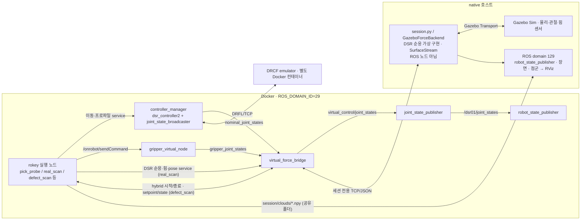

# M0609·RG2 표면 측정 개발 워크스페이스

2026-11-16 소스 기준. Doosan M0609와 OnRobot RG2로 탐침을 파지하고, 접촉 힘을 제어하며 표면을 측정하는 개발용 워크스페이스다. macOS에서는 Gazebo·RViz를 native로 실행하고 ROS 2 Jazzy 제어 노드는 Docker에서 실행한다.

로봇 프로그램과 인터페이스 상세는 [rokey README](ws_cobot_pjt/src/rokey/README.md)에 정리했다. `rokey-b3-project1/ws_cobot_pjt/`는 기본 이동·그리퍼 제어를 정리한 별도 배포본이며, 최신 스캔 코드는 이 워크스페이스의 `ws_cobot_pjt/src/rokey/`에 있다.

## 현재 구현 범위

| 구성 | 구현 내용 | 확인 상태·범위 |
|---|---|---|
| native 가상 환경 | M0609·RG2, 차량·탐침·거치대, 충돌과 힘 센서, Docker↔native TCP 연결 | 실행 코드와 측정 로그 존재 |
| 탐침 파지 | HOME → 거치대 접근 → RG2 파지 확인 → ProbeTCP/Tool 선택 → HOME | `pick_probe`, 거치대는 로봇 정면 기준 우측 (250, -400) mm |
| 보정 | `calibration.json`의 TCP·Tool 질량/무게중심을 가상 모델에 적용, 측정 기반 힘·높이 잡음 보정 도구 | TCP/Tool 프로파일 적용과 측정 기반 보정은 별도 경로 |
| 차량 수리 공정 | 차량 식별 → 부품 스캔·판정 → 재고 조회 → 교체·검사 → DB 기록 | `repair_manager`에 연결된 기존 공정 코드 |
| **실차 부품 스캔** | `real_scan`: 팀 차량 조립품(`--car real`)의 범퍼·본넷·몸체·문을 **고정 축 + DSR 힘제어·순응제어**로 긁어 실측 점군 생성 | 가상 세션 전용. 범퍼는 현재 배치에서 접근 불가 (아래 결과) |
| 블록 결함 측정 | `defect_scan`: 블록 윗면 1 mm 왕복, 크랙·덴트·힘·innovation·지연 분석 그래프 | hybrid 제어기(surface_follow)는 이 프로그램 전용으로만 남김 |
| 점군 | BASE 기준 실측 PLT/PLY, 기준 메시 PLY, native RViz 점군 표시 | `real_scan`은 `session/clouds`를 통해 native RViz에 기준·실측 점군 표시 |
| 웹 | URDF 로딩, 시뮬레이션 관절·장면 표시, 로봇 프로그램 실행 탭 | 기본 HTTP 5050, rosbridge 9090 |

PID·admittance 제어와 이를 쓰던 프로그램(연속 표면 추종 CLI, `adaptive_scan`, `cloud_scan`, `pid_scan`)은 삭제했다. 고정축 스캔에는 PID가 필요하지 않으며(힘은 측정만 함), **PID 제어는 이후 옵션으로 도입할 예정**이다.

## 디렉토리와 코드 관계

```text
ws_cobot_pjt/                              이 README의 디렉토리
├── README.md                             전체 구성·실행·노드 관계
├── Dockerfile / compose.yaml             ROS 개발 컨테이너 + DRCF 에뮬레이터
├── run_virtual.sh                        native/run_display.sh → session.py --mode virtual
├── run_real.sh                           session.py --mode real --host <IP>
├── run_rviz.sh                           session.py --mode real --observe-only
├── native/
│   ├── session.py                        세션·Docker·GUI·TCP 연결 수명 관리 (--car sedan|suv|sports|random|real)
│   ├── model_export.py / calibration.py   URDF/SDF 생성·TCP/Tool 보정 적용
│   ├── scene.py / scene.json              차량(팩 차량 또는 실차 조립품)·블록·반구·탐침 거치대 장면
│   │   └── rokey real_vehicle.py         --car real: 조립품 정렬·축척·50 mm 리프트·부품 분할
│   ├── probe_tool.py                     탐침·거치대 모델, 파지 계획
│   ├── virtual_force.py                  GazeboForceBackend: DSR 순응·힘 service의 가상 구현, 관절·힘 피드백
│   ├── surface_stream.py / normal_force.py  defect_scan hybrid 전용 연속 stream·법선 힘 servo(어드미턴스형)·Kalman
│   ├── setpoint_ramp.py                  관절 목표 500 Hz 보간
│   ├── displays.py                       Gazebo/RViz 표시와 native JointState 발행
│   │   └── clouds.py                     session/clouds/*.npy → /cobot_native/cloud/{reference,measured}
│   ├── ros_state_relay.py                실기/관찰 모드의 관절 상태 TCP 전달
│   ├── environment.yml                   cobot-native Conda 환경
│   └── results/                          과거 검증·비용 분석 기록(데이터)
├── practice/surface_lab/                  2D 표면 추종 실험 환경
├── ws_cobot_pjt/                          컨테이너 /workspace에 마운트하는 colcon workspace
│   ├── src/
│   │   ├── rokey/                        탐침·보정·측정·수리 프로그램
│   │   │   ├── README.md                 프로그램 호출 구조·ROS 인터페이스 상세
│   │   │   ├── rokey/real_scan.py         실차 부품 고정축 스캔 (part_scan 사용)
│   │   │   ├── rokey/part_scan/           기준 점군·높이맵·공구/팔 충돌·IK·DSR 힘제어 실행
│   │   │   ├── rokey/defect_scan.py       블록 결함 스캔·그래프 (surface_follow hybrid)
│   │   │   ├── rokey/surface_follow/      defect_scan 전용 hybrid 실행부
│   │   │   ├── config/                   robot / surface_following / vehicles
│   │   │   ├── meshes/vehicles/          rgsdev(팩 차량) · b3_project1(팀 차량 조립품 STL)
│   │   │   └── pointcloud/ · surface_runs/ · images/ · calibration/
│   │   └── cobot_rg2/
│   │       ├── doosan-robot2/             DSR hardware/controller·dsr_msgs2
│   │       ├── onrobot-ros2/              실제 RG2 드라이버·메시지·서비스
│   │       └── rg2/m0609_rg2_bringup/     launch·URDF·가상 그리퍼·force bridge
│   └── session/                          탐침 계획·장면 정답·보정 결과·점군 파일 공유
├── rokey-b3-project1/
│   ├── web/                              Flask·DB·URDF viewer·rosbridge 클라이언트
│   └── ws_cobot_pjt/                      기본 제어 배포본 스냅샷
├── ADAPTIVE_SCAN_PLAN.md                  (삭제된 adaptive_scan의 과거 설계 기록)
└── SURFACE_FOLLOWING_PLAN.md              표면 추종 설계 기록 (admittance·PID 코드는 삭제됨)
```

## Action·Service·Topic의 역할

| 방식 | 역할 | 현재 시스템에서의 사용 |
|---|---|---|
| **Action** | 시간이 걸리는 작업을 goal로 시작하고 feedback·result·cancel로 관리 | 벤더 DSR의 H2R 이동 action과 실기 OnRobot 드라이버의 gripper action이 존재한다. rokey의 스캔·수리 공정은 자체 action server/client가 없다. |
| **Service** | 요청과 응답을 한 쌍으로 처리 | HOME/접근 이동, TCP·Tool 설정, RG2 명령, 탐침 attach, DSR 순응·힘 설정, defect_scan의 hybrid stream 시작·종료 |
| **Topic** | 상태나 명령 스트림 전달 | JointState·TF·힘·PointCloud2, defect_scan의 40 Hz setpoint·state, 웹의 `/repair/command`와 `/repair/status` |

`real_scan`은 **service만** 쓴다: 이동(movel)·순응제어(`task_compliance_ctrl`)·목표 힘(`set_desired_force`)·상태 조회. `defect_scan`은 **service로 HOME/접근 → service로 hybrid stream 시작 → topic으로 setpoint/state 교환 → service로 종료** 순서다.

## 노드·프로세스 관계도

아래는 `run_virtual.sh --car ...` 기준이다. rokey 이동 프로그램은 필요한 것을 하나씩 실행한다.



컨테이너의 ROS domain은 **29**, native GUI 쪽은 **129**다. 두 환경은 bridge와 native backend 사이의 TCP로 연결되고, 컨테이너의 ROS topic은 native RViz에 보이지 않는다. 그래서 `real_scan`은 기준·실측 점군을 공유 폴더 `session/clouds/`에 쓰고, native `clouds.py`가 이를 1초마다 확인해 RViz의 `Cloud reference`(파랑)·`Cloud measured`(주황)로 발행한다.

## 빌드와 가상 환경 실행

### macOS native + Docker

```bash
conda env create -f native/environment.yml
docker compose build cobot
docker compose --profile virtual up -d --wait
docker exec -it ws_cobot_pjt bash
```

컨테이너에서 ROS 패키지를 빌드한다.

```bash
source /opt/ros/jazzy/setup.bash
cd /workspace
colcon build --symlink-install --packages-up-to m0609_rg2_bringup dsr_controller2 dsr_hardware2 onrobot_rg_control \
  --cmake-args -DBUILD_TESTING=OFF
source install/setup.bash
exit
```

호스트에서 가상 세션을 실행한다.

```bash
./run_virtual.sh --car real --probe ball      # 팀 차량 조립품: 로봇 정면, 앞이 로봇을 향함, 50 mm 리프트
./run_virtual.sh --car sedan --probe ball     # 팩 차량 + 블록·반구 (defect_scan, contact_scrape)
# --no-gazebo-gui: Gazebo 창 없이 RViz만, --web: 웹 탭 (http://localhost:5050/admin?tab=robot)
```

로봇 프로그램은 다른 터미널에서 컨테이너에 들어가 실행한다.

```bash
docker exec -it ws_cobot_pjt bash
source /opt/ros/jazzy/setup.bash && source /workspace/install/setup.bash
ros2 run rokey pick_probe
ros2 run rokey real_scan --part bonnet --plan-only   # 기준 점군·경로·접근 가능 비율만
ros2 run rokey real_scan --part bonnet               # --part bumper|bonnet|body|door
ros2 run rokey defect_scan --rows 2                  # --car sedan 장면에서
```

### 기존 수리 공정과 실기 연결

수리 공정은 컨테이너에서 `ros2 launch rokey repair.launch.py`로 실행한다(`repair_manager`, `repair_pointcloud`). 실기 연결은 `./run_real.sh <ROBOT_IP>`, 관찰은 `./run_rviz.sh`다. `real_scan`과 `defect_scan`은 현재 가상 세션으로 제한한다(`real_scan`은 차량 위치를 장면 정보에서 읽음).

## 결과와 검증 상태

`rokey/pointcloud/`에 실측·기준 점군이 저장된다. 실측은 `base_link`, m 단위다.

- `defect_scan`: 복원한 hybrid 경로로 2행(149 mm) 완료, 평균 1.50 N·표준편차 0.015 N (2026-11-16 13:13).
- `real_scan --plan-only` (공구 원기둥·팔 캡슐 충돌, URDF IK 포함): 본넷 접근 가능 98%·경로 7개·1,341 mm, 문(양쪽) 100%·경로 40개·3,154 mm, **범퍼 0%** — 범퍼 윗면은 22 mm 위를 차체 앞부분이 덮고, 앞면은 차량 앞 끝이 로봇에서 440 mm라 손목이 로봇 베이스와 겹친다. 범퍼를 측정하려면 차량을 더 멀리 두거나 축을 바꿔야 한다.
- `real_scan` 실행(DSR 힘제어·순응제어): 본넷 6개 경로 모두 완료(2026-11-16 13:23), 실측점 56,069개, 힘 평균 1.52 N·표준편차 0.27 N; 같은 1 mm 칸의 기준 윗면 대비 높이 중앙값 −0.02 mm(5–95%: −0.22 ~ +1.63 mm, 큰 값은 띠 돌기·가장자리에서 공이 이웃 면에 먼저 닿는 경우). 경로마다 HOME을 거쳐 약 9분.
