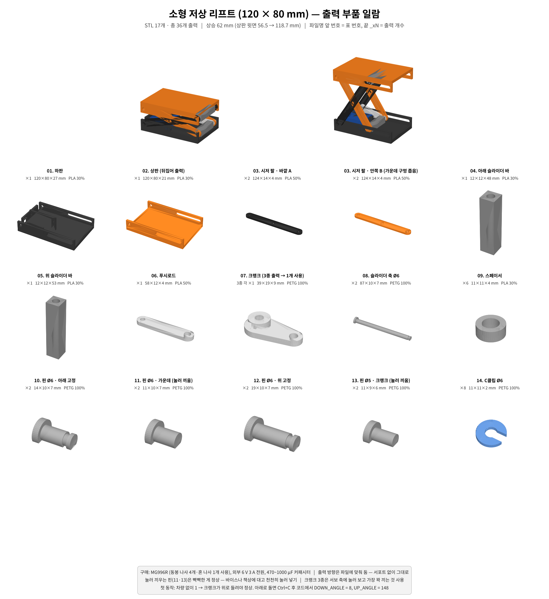

# 소형 저상 리프트 (상판·하판 120 × 80 mm)

| 항목 | 값 |
|---|---|
| 상판 윗면 높이 | 56.5 mm (내림) → 118.7 mm (올림), **상승 62 mm** |
| 하판 | 120 × 80 mm, 벽 높이 21.5 mm (서보 칸막이 부분만 27 mm) |
| 1 kg 기준 최대 필요 토크 | 4.2 kg·cm (MG996R @6 V 11 kg·cm → 여유 약 2.6배) |
| 서보 각도 | 172° 내림 / 32° 올림 (기존 제어 코드 그대로 사용) |

서보 32°~172° 전체 동작 구간에서 부품끼리 부딪히지 않는 것을 계산으로 확인했습니다.

## 이전(160 × 100) 버전과 달라진 점

- **팔 두께 6 → 4 mm, 팔 길이 147 → 110 mm:** 폭 80 mm 안에 서보·크랭크·팔이 모두 들어가도록 줄였습니다. 팔은 **바깥 A 2개, 안쪽 B 2개**로 나뉩니다. B는 가운데 구멍이 좁습니다(Ø5.9).
- **와셔 없음:** 부품 사이 간격(0.5 mm)이 설계에 들어가 있어서 와셔를 쓰지 않습니다.
- **눌러 끼우는 핀 2종 (클립 없음):**
  - 가운데 핀(11): B의 좁은 구멍에 꽉 끼워져 고정되고, A는 그 핀 위에서 돕니다.
  - 크랭크 핀(13): 푸시로드의 좁은 구멍(Ø4.9)에 꽉 끼워지고, 크랭크는 그 핀 위에서 돕니다.
- **기존 부품과 호환되지 않습니다.** 160 × 100 버전 부품은 이 버전에 쓸 수 없으니 전부 새로 출력하세요.

## 조립 순서

1. **서보:** 옆으로 눕혀 칸막이 구멍에 바닥 쪽부터 밀어 넣습니다. 출력축은 크랭크가 있는 쪽 긴 벽을 향하고, 몸체의 출력축 쪽 끝이 뒤쪽(슬라이더 쪽)에 오게 합니다. 동봉 나사 4개로 귀를 칸막이에 고정합니다.
2. **아래 고정핀(10):** 바깥에서 하판 벽 → 팔 A 앞쪽 끝 순서로 끼우고, 안쪽에서 클립을 끼웁니다.
3. **가운데 핀(11):** 팔 A 바깥쪽에서 A 가운데 구멍 → B 가운데 구멍 순서로 끼웁니다. B의 좁은 구멍에 끝까지 눌러 넣고(바이스나 책상 모서리 이용), 핀 끝이 B 안쪽 면과 같은 높이가 되게 합니다.
4. **아래 슬라이더 축(08):** 벽 슬롯 → 스페이서 → B → **아래 슬라이더 바(04) → 푸시로드 끝** → B → 스페이서 → 반대쪽 벽 슬롯 순서로 끼우고, 끝에 클립을 끼웁니다.
5. **크랭크(07):** `lift_keyboard.py`를 실행하고 `q`를 눌러 서보를 172°로 보냅니다. 크랭크 끝이 뒤쪽(슬라이더 쪽)을 향하고 살짝 위로 들리게 서보 축에 끼운 뒤, 혼 나사로 고정합니다.
6. **크랭크 핀(13):** 크랭크의 서보 쪽 면에서 크랭크 끝 → 푸시로드 순서로 꽂고, 푸시로드의 좁은 구멍에 눌러 넣습니다.
7. **상판:** 위 고정핀(12)으로 상판 날개 → 스페이서 → B 위쪽 끝을 연결하고 클립을 끼웁니다. 위 슬라이더 축(08)은 날개 슬롯 → A → 스페이서 → 위 슬라이더 바(05) → 스페이서 → A → 날개 슬롯 순서로 끼우고 클립을 끼웁니다.

## 처음 움직일 때

차량 없이 `1`을 누르면 크랭크가 **위로 들리며** 앞쪽으로 넘어가고 상판이 올라가야 정상입니다.

크랭크가 아래로 돌기 시작하면 바로 Ctrl+C를 누르세요. 그다음 코드에서 `DOWN_ANGLE = 8`, `UP_ANGLE = 148`로 바꾸고, 크랭크를 8° 위치에 다시 끼웁니다.

## 치수 수정

`source/compact/lc.py` 맨 위의 값을 고치고 `python3 lc.py`를 실행하면 STL을 다시 만듭니다. `check_c.py`로 간섭을 다시 검사할 수 있습니다.
