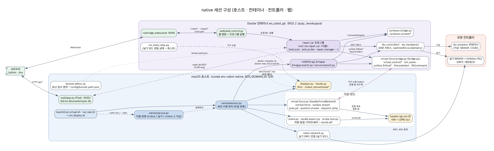
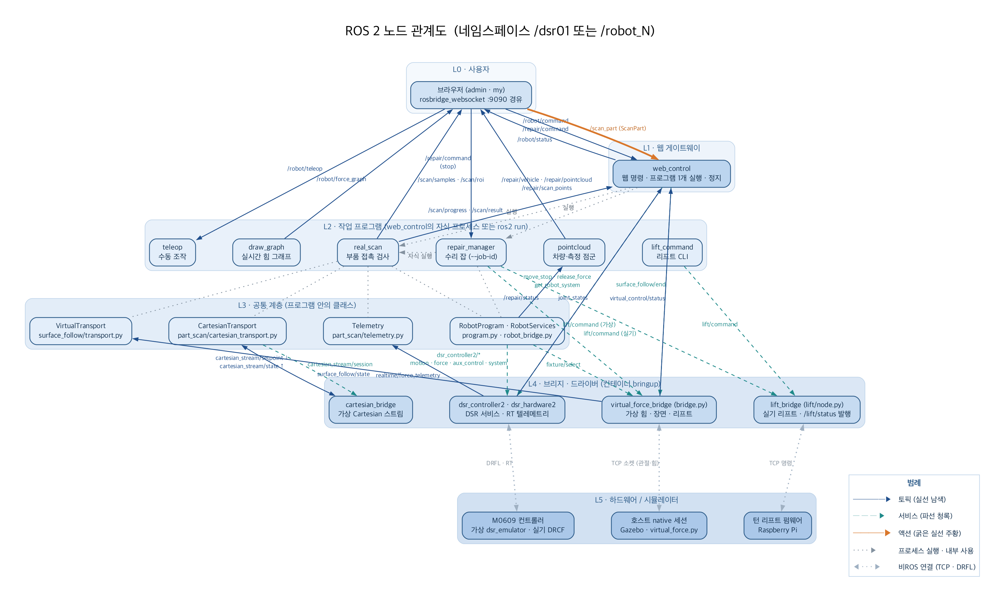

# repair_car · 탐침 기반 차량 표면 검사와 부품 교체

Doosan M0609와 OnRobot RG2로 구형 탐침을 잡고, 힘 제어로 차량 표면을 접촉 검사해 손상(dent·crack)을 찾은 뒤, 보닛·문을 티칭 좌표로 교체하는 ROS 2 Jazzy 패키지입니다. 기본 ROS 네임스페이스는 `/dsr01`, 다중 로봇이면 `/robot_N`입니다.

- 전체 구성과 실행 로직: [docs/ARCHITECTURE.md](docs/ARCHITECTURE.md)
- 기능별 문서: [NATIVE](docs/NATIVE.md) · [INSPECTION](docs/INSPECTION.md) · [REPAIR](docs/REPAIR.md) · [WEB](docs/WEB.md) · [ROS_INTERFACES](docs/ROS_INTERFACES.md)
- 실측 검출·ROI 보고서: [docs/real_scan_report_20261121.pdf](docs/real_scan_report_20261121.pdf)



## 빠른 실행

```bash
# 호스트 (macOS, conda env cobot-native)
./launch/run_virtual.sh --car demo_final --web     # 가상 세션 + 웹
./launch/run_real.sh <ROBOT_IP> --with-sim --web   # 실기 /robot_1 + 가상 /robot_2 + 웹

# 컨테이너
docker exec -it ws_cobot_pjt bash
colcon build --symlink-install --packages-select repair_car
ros2 run repair_car real_scan --part bonnet --controller mesh-height
```

웹: `http://localhost:5050/admin?tab=robot`

## 파일과 호출 관계

```text
repair_car/                               (ROS 패키지 루트)
├── setup.py                              ros2 run repair_car <이름> 24개 · meshes/ 트리 전체 설치
├── launch/
│   ├── run_virtual.sh · run_real.sh      → run_display.sh → native/session.py (단일) / native/service.py (다중)
│   ├── run_web.sh                        Flask(호스트) + rosbridge · web_control(컨테이너)
│   ├── run_rviz.sh · run_service.sh · run_lift.sh
│   └── repair.launch.py                  repair_manager + pointcloud (+ rosbridge)
├── native/                               호스트 측 (→ docs/NATIVE.md)
│   ├── session.py                        컨테이너 bringup · RViz · Gazebo 수명
│   │   ├── scene.py · model_export.py · probe_tool.py     장면 → world.sdf
│   │   │   └── repair_car.experiments.defect_block        시험 블록 결함 메시
│   │   ├── virtual_force.py              Gazebo 관절·접촉 힘 ↔ 컨테이너 virtual_force_bridge (TCP)
│   │   │   └── normal_force · surface_stream · pose_pd · position_stream · setpoint_ramp
│   │   ├── robot_network.py              실기 DRFL 중계
│   │   └── displays.py · clouds.py       RViz · data/clouds/*.npy → PointCloud2
│   ├── service.py · service_launch.py    다중 로봇 (/robot_N)
│   └── bonnet_editor.py                  → config/bonnet_path.json
├── repair_car/                           Python 패키지
│   ├── config.py                         robot.yaml 로드 · namespace_args/fleet_id · data/ 경로(output_dir)
│   ├── robot_control/
│   │   ├── program.py                    RobotProgram → robot_bridge.RobotServices · contact_probe · home_motion
│   │   ├── robot_bridge.py               robot_topic · program_args · DSR 서비스 호출(RobotServices)
│   │   ├── contact_probe.py · touch.py · cartesian_servo.py · rotations.py
│   │   ├── rg2_state.py                  실기 RG2 폭·파지 피드백
│   │   └── teleop.py                     /robot/teleop
│   ├── probe/
│   │   ├── pick_probe.py · release_probe.py   → real_probe_pickup.py (실기 거치대)
│   │   └── virtual_probe_profiles.py
│   ├── inspection/                       (→ docs/INSPECTION.md)
│   │   ├── real_scan.py                  CLI → scan_part → mesh_scan / default · rescan
│   │   ├── mesh_scan.py                  run_mesh_scan: 계획 → 실행 → ROI → 보고서
│   │   ├── scan_scene.py                 실기 배치 / 가상 장면 · fixture/select
│   │   ├── choose_car.py · scan_surface.py · prepare_scan_meshes.py
│   │   ├── part_scan/
│   │   │   ├── height_plan · bonnet_plan · mesh_plan · planner · cloud_plan   경로
│   │   │   ├── height_dsr (실기 movesx) · mesh_run · run · staged_scan          실행
│   │   │   ├── cartesian_transport · telemetry · scan_topics                   ROS 연결
│   │   │   ├── mesh_roi · crack_roi · cloud_roi · roi · staged_roi · rescan    ROI
│   │   │   └── archive.py                data/<차량>/<날짜>/<부품>/ 경로 규칙
│   │   └── surface_follow/transport.py   VirtualTransport (surface_follow/state)
│   ├── report/                           mesh_report → mesh_figures · damage_report · defect_map · draw_graph …
│   ├── geometry/                         mesh_io · real_vehicle · vehicle_model
│   ├── pointcloud/                       cloud(PartCloud 캐시) · publisher · pointcloud_file · mesh_to_pointcloud
│   ├── calibration/                      calibration · force_data · force_physics · force_offset · motion_offset(_check)
│   ├── experiments/                      contact_overshoot · contact_scrape · force_slide · performance_sample · defect_block
│   ├── part_replace/
│   │   ├── replace_parts.py              PartReplacer → TAUGHT: bonnet_replace · door_replace (자식 프로세스)
│   │   └── bonnet_replace.py · door_replace.py   티칭 DRL 포팅 (분해 · 조립)
│   ├── lift/                             node(lift_bridge) · command · firmware · turnlift/ (턴 리프트)
│   └── web/                              (→ docs/WEB.md, docs/REPAIR.md)
│       ├── app.py · db.py · robot_files.py · templates/ · static/      Flask :5050 (호스트)
│       ├── web_control.py                /robot/* · /repair/* · /scan_part → 자식 프로세스
│       │   ├── web_commands.py · web_inspection.py · web_process.py · web_home.py
│       ├── repair_manager.py             수리 잡 → real_scan · replace_parts · repair_db(REST)
│       └── check_db.py · repair_db.py
├── config/                               robot.yaml · real_scene.yaml · vehicles.yaml · bonnet_path.json · *.json 보정값
├── meshes/                               probes/(original · legacy) · holders/ · coupons/ · vehicles/
├── data/                                 세션 파일 · clouds/ · <차량>/<날짜>/<부품>/ 검사 결과 · web/repair.db
├── pointcloud/                           real_<part>_reference.ply 캐시 (폴더 유지)
├── images/                               터미널 실험·보정 그래프 (output_dir('images'))
├── Docker/                               compose.yaml (cobot · emulator) · Dockerfile
├── test/                                 오프라인 테스트
└── docs/                                 기능별 문서 · diagrams/(.dot) · images/(.png) · ppt_figures/
```

## ROS 인터페이스 요약



| 종류 | 이름 |
|---|---|
| 토픽 | `/robot/command` · `/robot/status` · `/repair/command` · `/repair/status` · `/robot/force_graph` · `/robot/teleop` · `/scan/{samples,roi,progress,result}` · `/repair/{vehicle,pointcloud,scan_points}` |
| 서비스 | `dsr_controller2/*` · `lift/command` · `fixture/select` · `surface_follow/end` · `cartesian_stream/session` |
| 액션 | `/scan_part` (ScanPart) |

자세한 표와 `custom_interfaces` 구조는 [docs/ROS_INTERFACES.md](docs/ROS_INTERFACES.md)를 봅니다.
