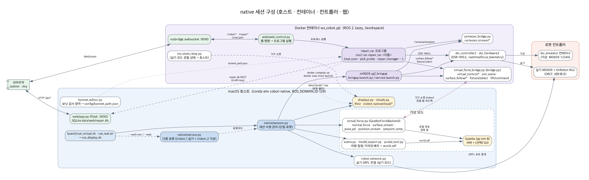
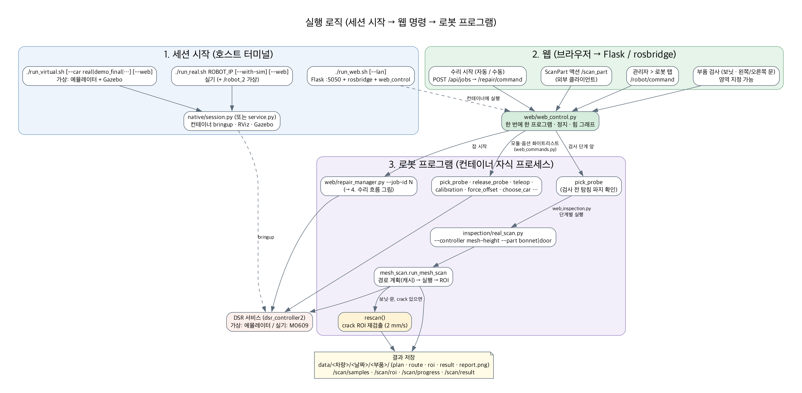

# 전체 구성과 실행 로직

repair_car는 Doosan M0609와 OnRobot RG2로 구형 탐침을 잡고, 힘 제어로 차량 표면을 접촉 검사한 뒤 손상 부품을 교체하는 ROS 2 Jazzy 패키지입니다.

## 세 실행 영역

| 영역 | 무엇이 도는가 | 문서 |
|---|---|---|
| macOS 호스트 (native) | 세션 관리(`native/session.py`), Gazebo, RViz, 가상 힘 제어, 보닛 영역 편집기, Flask 웹 서버 | [NATIVE.md](NATIVE.md), [WEB.md](WEB.md) |
| Docker 컨테이너 `ws_cobot_pjt` | DSR 컨트롤러 드라이버, 가상 브리지, `repair_car` 로봇 프로그램, `web_control`, rosbridge | [ROS_INTERFACES.md](ROS_INTERFACES.md) |
| 로봇 컨트롤러 | 가상: `dsr_emulator` 컨테이너, 실기: M0609 DRCF | — |

## 실행 로직

1. **세션 시작**: 호스트에서 `launch/run_virtual.sh` 또는 `launch/run_real.sh`를 실행합니다. `native/session.py`가 컨테이너 bringup, RViz, (가상이면) Gazebo를 띄웁니다.
2. **웹 연결**: `launch/run_web.sh`가 Flask(:5050)를 호스트에, rosbridge(:9090)와 `web_control`을 컨테이너에 붙입니다. `--web` 옵션으로 세션과 함께 띄울 수도 있습니다.
3. **로봇 프로그램**: 웹 명령은 `web_control`이 받아 한 번에 하나의 프로그램을 자식 프로세스로 실행합니다. 터미널에서는 `docker exec -it ws_cobot_pjt bash` 후 `ros2 run repair_car <이름>`으로 직접 실행합니다.

## 기능별 문서

| 문서 | 내용 |
|---|---|
| [NATIVE.md](NATIVE.md) | 호스트 native 세션: 가상/실기/다중 로봇, Gazebo·RViz, 공유 폴더 |
| [INSPECTION.md](INSPECTION.md) | `real_scan` 부품 접촉 검사, mesh-height 경로, ROI·crack 재검출 조건 |
| [REPAIR.md](REPAIR.md) | 웹 자동·수동 수리 흐름과 검증 결과 |
| [WEB.md](WEB.md) | Flask 웹 서버, `web_control`, 웹 명령 화이트리스트 |
| [ROS_INTERFACES.md](ROS_INTERFACES.md) | 노드·토픽·서비스·액션 관계, `custom_interfaces` 구조와 용도 |

도식 원본은 [diagrams/](diagrams)의 `.dot` 파일입니다. 수정 후 `dot -Tpng -Gdpi=150 diagrams/<이름>.dot -o images/<이름>.png`로 다시 만듭니다 (한글 글꼴: Apple SD Gothic Neo).
