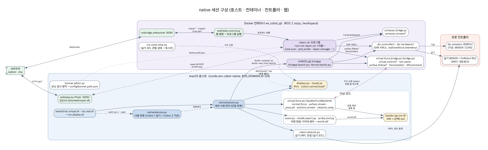

# native 세션 (macOS 호스트)

로봇 제어(ROS 2)는 Docker 컨테이너에서, 화면(RViz)과 가상 물리(Gazebo)는 호스트에서 실행합니다. 호스트 쪽 코드는 `native/`에 있고 conda 환경 `cobot-native`에서 실행됩니다.

## 시작 명령 (`launch/`)

| 명령 | 동작 |
|---|---|
| `./run_virtual.sh [--car real\|demo_front\|demo_left\|demo_right\|demo_final\|sedan …] [--probe ball] [--web]` | 가상 세션. 에뮬레이터 컨테이너 + Gazebo + RViz |
| `./run_real.sh ROBOT_IP [--car …]` | 실기 세션. RViz와 실기 컨트롤러 연결 |
| `./run_real.sh ROBOT_IP --with-sim [--web]` | `/robot_1` 실기(RViz) + `/robot_2` 가상(Gazebo)을 함께 (`native/service.py`) |
| `./run_web.sh [--lan]` | 실행 중인 세션에 웹(Flask·rosbridge·web_control) 연결 |
| `./run_rviz.sh` | 관찰 전용 RViz |
| `./run_lift.sh` | 턴 리프트 단독 시뮬레이션 (Gazebo 서버 + RViz) |

모든 시작 스크립트는 `run_display.sh`를 거쳐 `conda activate cobot-native` 후 `native/session.py`를 실행합니다.

## session.py가 하는 일

1. `Docker/compose.yaml`로 `ws_cobot_pjt` 컨테이너(가상이면 `emulator`도)를 띄웁니다.
2. **가상 모드**
   - `scene.py`·`model_export.py`·`probe_tool.py`가 차량·탐침·거치대를 배치한 `world.sdf`를 만들고 `gz sim` 서버(필요하면 GUI)를 실행합니다.
   - `virtual_force.py`(`GazeboForceBackend`)가 Gazebo 관절을 구동하고 접촉 힘을 계산합니다. 법선 힘 서보(`normal_force.py`), 연속 스트림(`surface_stream.py`), 자세 PD(`pose_pd.py`) 등을 씁니다.
   - 컨테이너의 `virtual_force_bridge.py`와 TCP 소켓(세션 토큰)으로 관절 목표와 힘 피드백을 주고받습니다.
3. **실기 모드**: `robot_network.py`가 실기 컨트롤러로 가는 DRFL 연결을 중계하고, 컨테이너의 `ros_state_relay.py`가 관절 상태를 호스트 RViz로 보냅니다.
4. 컨테이너에서 `m0609_rg2_bringup bringup.launch.py`(다중 로봇이면 `service.launch.py`)를 실행합니다.
5. `displays.py`가 RViz를 띄우고, `clouds.py`가 `data/clouds/{reference,measured}.npy`를 `/cobot_native/cloud/*` PointCloud2로 발행합니다.

호스트 RViz는 별도 ROS 도메인(129)을 씁니다. 컨테이너 ROS 그래프와 섞이지 않습니다.

## 그 밖의 native 모듈

| 파일 | 역할 |
|---|---|
| `bonnet_editor.py` | 보닛 검사 영역을 그려 `config/bonnet_path.json`에 저장 |
| `contact_mesh.py` | 실차 CAD에서 접촉 표면(`meshes/vehicles/b3_project1/assembly_surface.npz`) 준비 |
| `object_scene.py` | `--object` 장면 (YCB 물체) |
| `probe_grasp.py` · `probe_mount.py` · `collision_groups.py` | 가상 탐침 거치대↔그리퍼 고정 파지 |
| `calibration.py` · `inspect_real.py` | 컨트롤러 Tool/TCP 프로파일 적용·조회 |

## 경로 규칙

- native 파일은 `sys.path`에 `ws_cobot_pjt/src/repair_car`를 넣고 패키지 모듈을 `repair_car.config`, `repair_car.geometry.*` 형식으로 import합니다. `native/calibration.py`와 `repair_car/calibration/` 패키지가 이름이 같으므로 `repair_car/repair_car`를 `sys.path`에 넣지 않습니다.
- 메시 경로는 [`meshes/`](../meshes) 구조(probes · holders · coupons · vehicles)를 따릅니다.
- 세션 파일(`scene_truth.json`, `probe_plan.json`, `clouds/`)은 `data/`(다중 로봇이면 `data/robot_N/`)에 씁니다.
