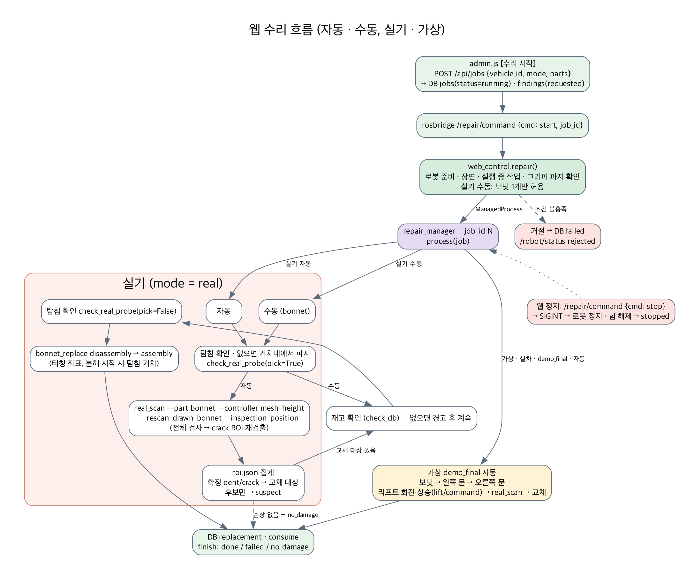

# 웹 수리 흐름 (자동 · 수동)

## 연결 순서

1. 관리자 화면 `admin.js` [수리 시작] → `POST /api/jobs {vehicle_id, mode, parts}` (`web/app.py`)
   - DB에 `jobs(status=running)`과 수동이면 `findings(decision=requested)`를 기록합니다. 실행 중인 잡이 있으면 409.
2. 브라우저가 rosbridge로 `/repair/command {cmd: start, job_id}`를 발행합니다.
3. `web_control.repair()`가 확인합니다: 로봇 준비, 장면, 다른 작업 실행 여부, 그리퍼 파지 피드백, 실기 수동은 보닛 1개만. 실패하면 DB를 `failed`로 닫고 `/robot/status`에 `rejected`를 보냅니다.
4. 통과하면 `repair_manager --job-id N`을 자식 프로세스로 실행합니다.
5. `repair_manager`는 `repair_db`(REST, `X-API-Key`)로 단계별 이벤트·판정·교체 결과를 DB에 기록합니다.
6. 정지: `/repair/command {cmd: stop}` → `web_control.stop()`이 SIGINT를 보내고, 자식이 로봇 정지·힘 해제 후 `stopped`로 종료합니다.

## 실기 (mode = real)

| 단계 | 자동 | 수동 (bonnet만) |
|---|---|---|
| 탐침 | `check_real_probe(pick=True)`: 잡고 있지 않으면 거치대에서 파지 | 같음 |
| 검사 | `real_scan --part bonnet --controller mesh-height --rescan-drawn-bonnet --inspection-position` (전체 검사 → crack 재검출) | 생략 |
| 판정 | 각 실행의 `roi.json` 집계: 확정 dent/crack → 교체 대상, 후보만 → `suspect`, 없으면 `no_damage` 종료 | 요청한 부품 |
| 재고 | `check_db` (없으면 경고 후 계속) | 같음 |
| 교체 | `check_real_probe(pick=False)` → `bonnet_replace disassembly` → `assembly` (티칭 좌표, 분해 시작 시 탐침을 거치대에 내려놓음) | 같음 |
| 기록 | `replacement` · 재고 차감 · `done`/`failed` | 같음 |

실기 자동 검사 대상은 `REAL_SCAN_PARTS = ('bonnet',)`입니다. 실기에서 문은 자동 검사·교체하지 않습니다.

## 가상

- **demo_final 자동**: 보닛 → 왼쪽 문 → 오른쪽 문 순서로 탐침 확인 → HOME → 턴테이블 회전·리프트 상승(`lift/command`, 필요하면 `/fixture/select`) → `real_scan` → 티칭 교체(`bonnet_replace`, `door_replace --side`).
- **모형 차량(sedan/suv/sports) 자동**: 보정 → 차량 위치 → `scan_surface` → 판정 → 교체(`replace_parts` 뼈대, 가상에서만 로그로 성공 처리).
- 실패한 단계는 HOME 복귀 후 다시 시작합니다 (`retry`). 웹 정지만 잡을 끝냅니다.

## 검증 (2026-11-22)

컨테이너에서 실기 모드 `RepairManager.run()`을 로봇·DB 없이 모의 실행해 자식 명령 순서를 확인했습니다.

| 경우 | 결과 |
|---|---|
| 실기 자동 | 탐침 파지 확인 → `real_scan … --rescan-drawn-bonnet --inspection-position` → crack 확정 → 탐침 확인 → `bonnet_replace disassembly` → `assembly` → `done` |
| 실기 수동 `['bonnet']` | 탐침 파지 확인 → 탐침 확인 → `bonnet_replace disassembly` → `assembly` → `done` |
| 실기 수동 `['door_fl']` | `실기 수동 교체는 보닛 한 부품을 지원합니다.` → `failed` (web_control도 같은 조건으로 거절) |

남은 점:
- `RepairManager(front_confirmed)`와 `--front-placement-confirmed`는 받기만 하고 쓰지 않습니다.
- 가상 수동 교체에서 문(`door_fl`/`door_fr`)만 요청해도 `prepare_virtual('bonnet')`으로 보닛 배치를 준비합니다. 문 교체는 demo_final 배치를 기대하므로 맞지 않을 수 있습니다.
- `repair_manager.py`의 `DEMO_PANELS` 옆 주석("real vehicle: parts scanned in auto mode")은 `REAL_SCAN_PARTS`에 대한 설명입니다.
