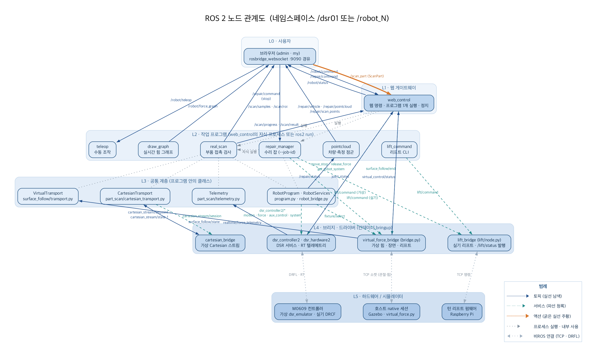
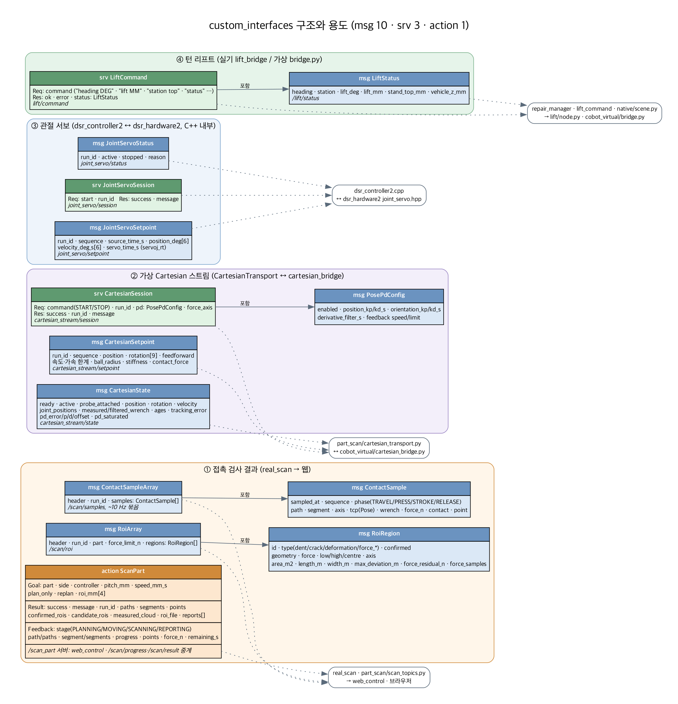

# ROS 인터페이스

모든 이름은 로봇 네임스페이스(`/dsr01`, 다중 로봇이면 `/robot_N`) 아래입니다. `/`로 시작하는 이름은 `robot_topic()`이 다중 로봇에서 네임스페이스를 붙입니다.

## 토픽

| 토픽 | 타입 | 발행 → 구독 |
|---|---|---|
| `/robot/command` | String (JSON) | 브라우저 → web_control |
| `/robot/status` | String (JSON) | web_control → 브라우저 |
| `/repair/command` | String (JSON) | 브라우저 → web_control (start/stop), repair_manager (stop) |
| `/repair/status` | String (JSON) | RobotProgram → 브라우저, pointcloud |
| `/repair/vehicle` · `/repair/pointcloud` · `/repair/scan_points` | String · PointCloud2 | pointcloud → 브라우저·RViz |
| `/robot/force_graph` | String (JSON 묶음) | draw_graph → 브라우저 |
| `/robot/teleop` | String | 브라우저 → teleop |
| `/scan/samples` | ContactSampleArray | real_scan → 브라우저 |
| `/scan/roi` | RoiArray | real_scan → 브라우저 |
| `/scan/progress` · `/scan/result` | ScanPart.Feedback · ScanPart.Result | real_scan → web_control (액션으로 중계) |
| `realtime/force_telemetry` | dsr_msgs2/ForceTelemetry | dsr_hardware2 → part_scan/telemetry.py |
| `surface_follow/state` | String | virtual_force_bridge → VirtualTransport |
| `virtual_control/status` · `wrench` · `sim_joint_states` · `sim_scene` | String · WrenchStamped · JointState · MarkerArray | virtual_force_bridge → web_control·RViz |
| `cartesian_stream/setpoint` | CartesianSetpoint | CartesianTransport → cartesian_bridge |
| `cartesian_stream/state` | CartesianState | cartesian_bridge → CartesianTransport |
| `/lift/status` | LiftStatus | lift_bridge → (모니터링) |

## 서비스

| 서비스 | 타입 | 클라이언트 → 서버 |
|---|---|---|
| `dsr_controller2/{motion,force,aux_control,system,tool,tcp,io}/*` | dsr_msgs2 | RobotServices(robot_bridge.py), web_control → dsr_controller2 |
| `lift/command` | LiftCommand | repair_manager, lift_command, native/scene.py → lift_bridge(실기) · virtual_force_bridge(가상) |
| `fixture/select` | SetCommand | ScanScene → virtual_force_bridge |
| `surface_follow/end` | std_srvs/Trigger | web_control → virtual_force_bridge |
| `cartesian_stream/session` | CartesianSession | CartesianTransport → cartesian_bridge |
| `joint_servo/session` | JointServoSession | dsr_controller2 → dsr_hardware2 (C++ 내부) |

## 액션

| 액션 | 타입 | 서버 |
|---|---|---|
| `/scan_part` | ScanPart | web_control: goal을 받아 `real_scan`을 실행하고 `/scan/progress` · `/scan/result`를 feedback · result로 중계 |

## custom_interfaces

| 묶음 | 인터페이스 | 용도 |
|---|---|---|
| ① 접촉 검사 결과 | `action/ScanPart`, `msg/ContactSampleArray` · `ContactSample`, `msg/RoiArray` · `RoiRegion` | real_scan의 진행·결과·샘플·ROI를 웹에 전달 (BASE, SI 단위) |
| ② 가상 Cartesian 스트림 | `srv/CartesianSession`, `msg/PosePdConfig`, `msg/CartesianSetpoint`, `msg/CartesianState` | 가상 mesh 스캔에서 TCP 자세 목표 스트림과 상태 |
| ③ 관절 서보 | `srv/JointServoSession`, `msg/JointServoSetpoint`, `msg/JointServoStatus` | dsr_controller2 → dsr_hardware2 `servoj_rt` (C++ 내부) |
| ④ 턴 리프트 | `srv/LiftCommand`, `msg/LiftStatus` | 리프트 펌웨어 명령 한 줄과 상태 (실기·가상 공통) |

정의 파일은 `ws_cobot_pjt/src/custom_interfaces/{msg,srv,action}/`에 있습니다.
