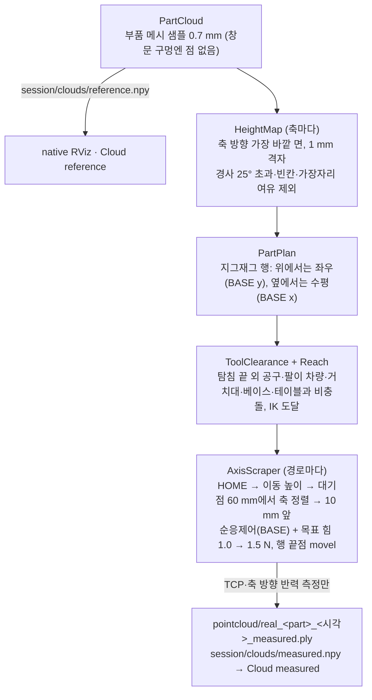

# rokey: 탐침 기반 표면 측정과 수리 공정

2026-11-16 소스 기준. 전체 환경·Docker·native 실행은 [워크스페이스 README](../../../README.md)를 참고한다. 실행 진입점은 [setup.py](setup.py), 기본 ROS namespace는 `/dsr01`이다.

## 모듈과 호출 관계

들여쓰기는 파일 소유 관계와 호출 관계다. `RobotProgram`, `SurfaceRun`, `AxisScraper` 등은 독립 ROS 노드가 아니라 실행 노드 내부의 객체다.

```text
rokey/
├── setup.py → ros2 run rokey <실행 이름>
├── launch/repair.launch.py
│   ├── repair_manager → /dsr01/repair_manager
│   │   ├── pick_probe.ProbePickup          필요할 때 탐침 파지
│   │   ├── calibration                    힘 모델·접촉 문턱·높이 잡음
│   │   ├── choose_car                     차량 종류·BASE 기준 위치 식별
│   │   ├── scan_surface                   기존 부품 측정·손상 판정
│   │   ├── check_db / replace_parts       재고 확인·교체·재검사
│   │   └── repair_db                      Flask REST API 호출
│   ├── pointcloud → /repair_pointcloud    기준 차량·기존 측정점 PointCloud2
│   └── rosbridge_server                   rosbridge:=true일 때만
├── rokey/program.py → RobotProgram
│   ├── configs.py                        robot.yaml + session 보정 결과
│   ├── robot_services.py                 DSR service client (movel·순응·힘·fkin/ikin)
│   ├── contact_probe.py → ContactProbe   영점·순응 on/off·목표 힘·movel(측정 콜백)·정지
│   └── rotations.py                      ZYZ·axis-angle·align(공구 +Z를 법선 반대로)
├── rokey/real_scan.py → /dsr01/real_scan  실차 부품 고정축 스캔 (가상 --car real)
│   ├── real_vehicle.py → RealVehicle      조립품 STL 정렬·축척·리프트, 부품 분할(bumper/bonnet/door/body)
│   └── part_scan/
│       ├── cloud.py → PartCloud, HeightMap   기준 점군, 고정 축 방향 높이맵(경사·빈칸·가장자리 제외)
│       ├── planner.py → PartPlan          좌우/수평 지그재그 행, 접근·이탈 가능 구간만
│       ├── tool.py → ToolClearance, Reach  공구 원기둥·팔 캡슐 충돌, URDF IK 도달성
│       ├── kinematics.py → RobotChain     URDF FK/Jacobian·국소 IK
│       └── run.py → AxisScraper, CloudChannel  DSR 순응+목표 힘 → movel 긁기, 측정만; RViz 점군 파일
├── rokey/defect_scan.py                  블록 결함 스캔 (크랙·덴트) → 그래프·CSV
│   ├── block_scan.RasterPath → SurfaceRun(hybrid)
│   └── ScanMap                           높이·힘·innovation·지연·법선 분석과 그래프
├── rokey/surface_follow/                 defect_scan 전용 hybrid 실행부
│   ├── runtime.py → SurfaceRun            HOME·접근·접촉·추종·이탈·저장
│   ├── controllers.py → HybridFollower    접선 위치 + native 법선 힘 목표(바깥 PI), 모멘트 칼만 검사
│   ├── geometry.py / governor.py          경로·접촉에 따른 감속
│   ├── transport.py → VirtualTransport   native stream service/topic 연결
│   ├── samples.py / recording.py          계측 레코드·추적 로그·packed XYZ 발행
│   └── pointcloud_file.py                PLT/PLY 저장 (real_scan도 사용)
├── rokey/contact_scrape.py               블록·반구 긁기 (DSR 순응·힘 service만)
├── rokey/force_data.py / force_physics.py / force_learning.py   측정 기반 힘 보정
├── rokey/vehicle_model.py / mesh_to_pointcloud.py               팩 차량 메시·높이맵·기준 PLY
├── rokey/web_control.py / web_commands.py / web_home.py         웹 로봇 탭의 프로그램 실행
├── config/robot.yaml                      로봇·이동·검사·블록 실험·real_scan 설정
├── config/surface_following.yaml          defect_scan hybrid 설정, SI 단위
├── config/vehicles.yaml                   팩 차량 + 실차 조립품(real) 설정
├── meshes/vehicles/b3_project1/          팀 차량 조립품 assembly.stl + SOURCE.json
└── calibration.json                       실제 TCP·Tool 프로파일의 가상 환경 적용 입력
```

PID·admittance 제어, `surface_follow` CLI, `adaptive_scan`·`refinement`, `cloud_scan`·`cloud_surface`, `vehicle_cloud`, `pid_scan`은 삭제했다. 남은 hybrid 제어기는 `defect_scan`(과 그 그래프)을 위한 것이다. **PID 제어는 이후 옵션으로 도입할 예정**이다.

## real_scan: 실차 부품 고정축 스캔



- **고정 축** (`robot.yaml real_scan.axes`): bonnet +z, bumper +z, door ±y(양쪽 문), body +z·±y. 노멀 벡터를 쓰지 않으며 스캔 중 공구가 회전하지 않는다.
- **힘제어·순응제어만**: `task_compliance_ctrl`(BASE) + `set_desired_force`(축 방향)로 DSR이 힘을 유지하고, 프로그램은 movel로 행을 긁으며 TCP와 축 방향 힘을 측정만 한다. 측정한 힘은 명령에 영향을 주지 않는다(과부하 8 N 보호만).
- **접근 가능 영역**: 공구를 원기둥 4개(축 3 mm, 탐침 몸체 23 mm, RG2 47 mm, 손목 52 mm 반경)로, 팔을 관절 사이 캡슐로 검사한다. 장애물은 차량 전체(부품 외 바퀴 등 포함), 탐침 거치대 판, 로봇 베이스 기둥, 테이블이다.
- **부품 분할** (`vehicles.yaml real`): 조립품의 연결 바디 단위. 본넷·범퍼는 시드 점의 바디, 몸체는 외곽 바디, 문은 몸체 중 x -44..40 mm, z 45..135 mm의 측면 삼각형(창문은 메시 없음).
- **장면**: 차량은 로봇 정면(BASE +x), 앞이 로봇을 향하고(yaw 180°), 앞 범퍼 끝 x = 440 mm, 테이블에서 50 mm 리프트. 전장 250 mm(조립품 단위 불명, 축척 설정값).

## defect_scan: 블록 결함 스캔 (hybrid)

HOME·자유 공간 영점·접근 → SEARCH → CONFIRM → SETTLE → TRACK → 이탈·HOME. `HybridFollower`는 경로 자체 시계로 접선 위치를 주고, 바깥 PI가 공구 축 방향 힘으로 native 법선 힘 servo(어드미턴스형, Kalman)의 목표를 정한다. 공구는 경로(모델) 법선을 따른다. 크랙·단차는 governor 감속·edge·HOP으로 넘는다. 모멘트 검사는 공구 x·y 잔차 모멘트의 칼만 필터 값으로 판정한다(0.025 N·m, 0.2 s).

## 노드별 역할

| 노드·구성 | 실행 위치 | 역할·연결 |
|---|---|---|
| `/dsr01/controller_manager`, `dsr_controller2` | Docker | ros2_control, 이동·프로파일·I/O service; DRCF와 연결 |
| `/dsr01/virtual_force_bridge` | Docker, native 가상 세션 | 힘·pose·순응 service 대리 처리, hybrid stream·Gazebo 피드백·장면 전달 |
| `/dsr01/gripper_virtual_node` | Docker, 가상 모드 | RG2 service → 관절 목표, `gripper_joint_states` |
| `/dsr01/joint_state_publisher`, `robot_state_publisher` | Docker | 관절 상태 통합, TF |
| `/dsr01/pick_probe` | Docker, CLI | RG2 파지·attach·ProbeTCP/Tool 선택 |
| `/dsr01/real_scan` | Docker, CLI | 실차 부품 고정축 스캔 |
| `/dsr01/defect_scan`, `/dsr01/contact_scrape` | Docker, CLI | 블록 결함 스캔 / 블록·반구 긁기 |
| `/dsr01/repair_manager`, `/repair_pointcloud` | Docker, repair launch | 수리 공정, 기준·측정 점군 |
| `/cobot_native/*` (joint source, robot_state_publisher, clouds) | 호스트 domain 129 | native RViz 로봇·장면·`Cloud reference/measured` |

`native/session.py`, `GazeboForceBackend`, `SurfaceStream`, `NormalForceServo`는 호스트 Python 객체이며 ROS 노드가 아니다.

## Service·Topic

| 경로 | 타입 | 용도 |
|---|---|---|
| `/dsr01/dsr_controller2/motion/move_joint`, `move_line`, `check_motion`, `move_stop` | `dsr_msgs2/srv/*` | HOME·movel(real_scan 긁기 포함)·정지 |
| `/dsr01/dsr_controller2/aux_control/get_current_posx`, `get_tool_force` | 같은 패키지 | 가상 모드에서는 bridge가 Gazebo pose/힘 제공 |
| `/dsr01/dsr_controller2/force/task_compliance_ctrl`, `set_desired_force`, `release_force`, `release_compliance_ctrl` | 같은 패키지 | real_scan·contact_scrape의 순응·힘제어 (가상은 native backend가 구현) |
| `/onrobot/sendCommand`, `/dsr01/probe/attach` | `SetCommand`, `Trigger` | 탐침 파지·고정 |
| `/dsr01/surface_follow/hybrid`, `/dsr01/surface_follow/end` | `std_srvs/srv/Trigger` | defect_scan hybrid stream 시작·종료 (admittance는 삭제) |
| `/dsr01/surface_follow/setpoint`, `/state` | `std_msgs/msg/String` JSON | defect_scan 40 Hz 명령·상태 |
| `/dsr01/surface_follow/status`, `/points` | String / PointCloud2 | defect_scan 진행·접촉점 (Docker graph) |
| `/cobot_native/cloud/reference`, `/measured` | PointCloud2 (domain 129) | real_scan 점군을 native RViz에 표시 (`session/clouds/*.npy`에서) |
| `/repair/command`, `/repair/status`, `/repair/vehicle`, `/repair/pointcloud` | String / PointCloud2 | 수리 공정·웹 |

## 실행과 확인

```bash
source /opt/ros/jazzy/setup.bash && cd /workspace
colcon build --symlink-install --packages-select rokey && source install/setup.bash
ros2 run rokey pick_probe
ros2 run rokey real_scan --part bonnet --plan-only     # 경로·접근 가능 비율만, 로봇 정지
ros2 run rokey real_scan --part door [--pitch 3] [--speed 4]
ros2 run rokey defect_scan [--rows N] [--from-row K]   # --car sedan 장면
```

결과: `pointcloud/real_<part>_<시각>_{reference,measured}.ply`(BASE m; measured는 x y z normal_force_n), defect_scan은 `images/defect_scan_<시각>.png/.csv`와 `surface_runs/<시각>_hybrid/`.

## 검증 상태와 남은 작업

- defect_scan: 복원한 hybrid 경로로 2행 완료(평균 1.50 N, 표준편차 0.015 N).
- real_scan 계획: 본넷 98%·경로 7개, 문 100%·경로 40개(창문 구멍으로 행이 끊김), 범퍼 0%(현재 배치에서 위·앞 모두 공구 충돌).
- real_scan 실행: 본넷 6개 경로 모두 완료(2026-11-16 13:23), 실측점 56,069개, 힘 평균 1.52 N·표준편차 0.27 N; 같은 1 mm 칸의 기준 윗면 대비 높이 중앙값 −0.02 mm(5–95%: −0.22 ~ +1.63 mm, 큰 값은 띠 돌기·가장자리에서 공이 이웃 면에 먼저 닿는 경우). 경로마다 HOME을 거쳐 약 9분.
- 남은 작업: 범퍼 접근(차량 배치·축 변경), 경로 사이 HOME 생략(접근·이탈 상대 movel), 실기 적용 시 차량 위치 입력, 이후 PID 옵션.
